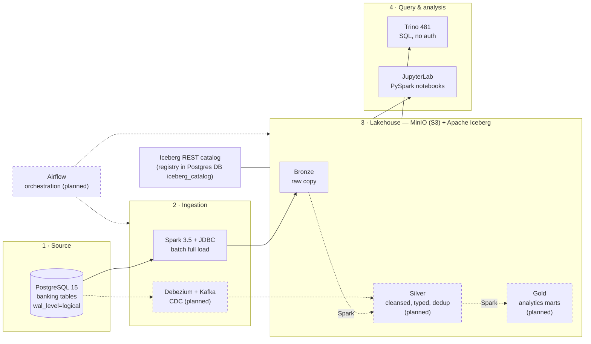

# LakeHouse_Banking

End-to-end banking lakehouse platform for transaction analytics, running locally on Docker Compose.

**Current status — Phase 1 (foundation):** the core stack (MinIO, Postgres, Spark, Iceberg REST, Trino, Jupyter) is up, and the first pipeline ingests banking source tables from Postgres into the **bronze** layer (Iceberg on MinIO, partitioned by business date `cob_dt`). Silver / gold layers, CDC (Debezium) and orchestration are not built yet.

For day-to-day commands, see **[how_to_run.md](how_to_run.md)**.

---

## Data layers & tech stack

Solid lines = built, dashed = planned. Table-level flow and relationships: [data_dictionary.md](data_dictionary.md).



| Concern | Tool | Version | Status |
|---|---|---|---|
| Source database | PostgreSQL | 15 (alpine) | Built |
| Object storage | MinIO (S3-compatible) | 2025.5.24 | Built |
| Table format | Apache Iceberg (format v2, Parquet + Snappy) | 1.4.3 (Spark runtime) | Built |
| Catalog | Iceberg REST catalog, JDBC registry in its own Postgres database `iceberg_catalog` | tabulario 1.6.0 | Built |
| Processing / ingestion | Apache Spark standalone (PySpark, Python 3.8) | 3.5.0 | Built |
| SQL query engine | Trino (no authentication, plain HTTP) | 481 | Built |
| Notebooks | JupyterLab | 4.3.8 | Built |
| Change data capture | Debezium + Kafka | — | Planned |
| Orchestration | Apache Airflow | — | Planned |
| Runtime | Docker Compose (network `lakehouse-net-dungafk`) | — | Built |

## Architecture

Container-level view:

```
                         ┌──────────────────────── lakehouse-net-dungafk ────────────────────────┐
                         │                                                                        │
  Postgres 15            │   Spark 3.5.0 standalone                     MinIO (S3)                │
  (source DB)       ── JDBC ──►  master + worker  ── Iceberg (S3FileIO) ► bucket "lakehouse"     │
  crm, core_banking,     │      ▲                 ── s3a:// files ─────►  bucket "lab" (notebooks)│
  payment schemas        │      │                          │                    ▲                  │
                         │  spark-client (spark-submit)    ▼                    │                  │
                         │  jupyter (notebooks)      Iceberg REST catalog ──────┘                  │
                         │                           (registry in Postgres DB iceberg_catalog)     │
                         │                                 ▲                                       │
                         │                           Trino (SQL on Iceberg)                        │
                         └────────────────────────────────────────────────────────────────────────┘
```

## Services

| Container | Image | Role | Host port(s) |
|---|---|---|---|
| `minio-dungafk` | `bitnamilegacy/minio:2025.5.24` | S3-compatible object storage | 9000 (API), 9001 (console) |
| `minio-init-dungafk` | `bitnamilegacy/minio-client:2025.5.21` | One-shot: creates buckets `lakehouse` and `lab`, then exits | — |
| `postgres-dungafk` | `postgres:15-alpine` | Two databases: `POSTGRES_DB` = banking source data (`wal_level=logical`, ready for CDC); `ICEBERG_CATALOG_DB` = Iceberg catalog registry | 5432 |
| `spark-master-dungafk` | `lakehouse-spark:3.5.0` (custom) | Spark standalone master | 8080 (UI), 7077 |
| `spark-worker-dungafk` | `lakehouse-spark:3.5.0` (custom) | Spark worker | 8081 |
| `spark-client-dungafk` | `lakehouse-jupyter:3.5.0-jlab4.3.8` (custom) | Idle container used to run `spark-submit` | 4040 (app UI) |
| `jupyter-dungafk` | `lakehouse-jupyter:3.5.0-jlab4.3.8` (custom) | JupyterLab with a "PySpark (Lakehouse)" kernel | 8888, 4041 |
| `iceberg-rest-dungafk` | `tabulario/iceberg-rest:1.6.0` | Iceberg REST catalog (warehouse `s3://lakehouse/`) | 8181 |
| `trino-dungafk` | `trinodb/trino:481` | SQL query engine over the `lakehouse` Iceberg catalog (no authentication) | 8085 (HTTP) |

Custom images:
- **`lakehouse-spark:3.5.0`** — `apache/spark:3.5.0` (Java 11, Scala 2.12, Python 3.8) + Iceberg 1.4.3 (`iceberg-spark-runtime`, `iceberg-aws-bundle`), `hadoop-aws` 3.3.4, AWS SDK bundle, Postgres and Oracle JDBC drivers.
- **`lakehouse-jupyter:3.5.0-jlab4.3.8`** — built on `lakehouse-spark:3.5.0` + JupyterLab 4.3.8, pandas, pyarrow, boto3, psycopg2, oracledb. The startup script creates a `spark` session automatically in the PySpark kernel.

## Project structure

```
LakeHouse_Banking/
├── docker-compose.yml             # Whole Phase 1 stack
├── .env                           # Credentials, endpoints, resource limits (git-ignored, never commit)
├── .env.example                   # Committed template for .env
├── how_to_run.md                  # Command cheat sheet
├── data_dictionary.md             # Tables, columns, layers, data quirks
├── conf/
│   ├── spark-defaults.conf        # Mounted into every Spark container (Iceberg catalog, S3A, resources)
│   └── trino/                     # Trino config, catalog/lakehouse.properties (Iceberg REST)
├── docker/
│   ├── spark/                     # Dockerfile (Spark + Iceberg/S3/JDBC JARs)
│   └── jupyter/                   # Dockerfile, PySpark kernel, IPython startup script
├── init-sql/postgres/             # Source schema + seed data (runs on first Postgres start)
├── jobs/
│   ├── common/
│   │   └── parsers.py             # Shared command-line value parsers: parse_date, parse_prefix
│   └── bronze/
│       ├── bronze_columns.py      # Only shared code: add_technical_columns() (cob_dt, ..., _source_filter, _row_hash)
│       ├── crm/                   # ingest_customer.py
│       ├── core_banking/          # ingest_account.py, ingest_core_account.py, ingest_transaction.py
│       ├── payment/               # ingest_merchant_transaction.py
│       └── auto/                  # CSV-driven bronze jobs (see "Pipeline: bronze ingestion")
│           ├── bronze_jobs.csv    # Job list: domain, table, load_type, event_col, active
│           ├── job_config.py      # Reads + validates the CSV
│           ├── run_domain.py      # Runs all active tables of one domain, one Spark app each, logs errors
│           ├── param/             # Approach B
│           │   └── ingest_table.py    # One parameterised job (--domain --table)
│           └── generate/          # Approach A
│               ├── generate_jobs.py   # Writes one job file per CSV row into generated/
│               ├── templates/         # snapshot / incremental job templates
│               └── generated/         # Output — wiped and rebuilt on every generator run, do not edit
├── logs/                          # Job logs, mounted at /home/spark/logs in spark-client (git-ignored)
├── known_issues/                  # Errors / data problems already met, cause + fix (read first when something breaks)
└── notebooks/                     # Mounted into Jupyter at /opt/notebooks (empty)
```

`jobs/` is mounted at `/home/spark/jobs` in `spark-client-dungafk` and `jupyter-dungafk`.

## Source data (Postgres database `POSTGRES_DB` from `.env`)

Created by `init-sql/postgres/*.sql`, one schema per business domain (`public` is empty; the Iceberg catalog lives in the separate database `ICEBERG_CATALOG_DB`):

| Schema (domain) | Table | Rows | Description |
|---|---|---|---|
| `crm` | `customer` | 20 | Bank customers (segment RETAIL / PRIORITY / VIP) |
| `core_banking` | `account` | 200 | Accounts (CHECKING / SAVINGS / CREDIT) linked to `crm.customer` |
| `core_banking` | `transaction` | 10,000 | 2,000 transactions/day over the last 5 days, linked to `account` |
| `core_banking` | `core_account` | 7 | Core banking accounts — planned CDC source (upsert into Iceberg) |
| `payment` | `merchant_transaction` | 10 | Card payments at merchants — planned CDC source (aggregation) |

Column-level details, allowed values, bronze mapping and known data quirks: [data_dictionary.md](data_dictionary.md).

## Pipeline: bronze ingestion

Each Postgres source table has **its own job** `jobs/bronze/<domain>/ingest_<table>.py` that copies it into an
**Iceberg** table `lakehouse.bronze_<domain>.<table>` (domains `crm`, `core_banking`, `payment`), **one partition per
business date `cob_dt`**. Each job is **self-contained** (own source query, write, checks and command line); the only
shared code is `add_technical_columns()` in `jobs/bronze/bronze_columns.py` and the argument parsers in
`jobs/common/parsers.py`. One job = one future Airflow task.

| Job | Source → bronze table |
|---|---|
| `jobs/bronze/crm/ingest_customer.py` | `crm.customer` → `lakehouse.bronze_crm.customer` |
| `jobs/bronze/core_banking/ingest_account.py` | `core_banking.account` → `lakehouse.bronze_core_banking.account` |
| `jobs/bronze/core_banking/ingest_core_account.py` | `core_banking.core_account` → `lakehouse.bronze_core_banking.core_account` |
| `jobs/bronze/core_banking/ingest_transaction.py` | `core_banking.transaction` → `lakehouse.bronze_core_banking.transaction` |
| `jobs/bronze/payment/ingest_merchant_transaction.py` | `payment.merchant_transaction` → `lakehouse.bronze_payment.merchant_transaction` |

### CSV-driven jobs (`jobs/bronze/auto/`)

The job list lives in `jobs/bronze/auto/bronze_jobs.csv`
(`domain,source_table,target_table,load_type,event_col,columns,source_filter,active`): the target table name may differ
from the source, `columns` defines the columns to load with their types (`name:type|...`, becomes a StructType),
`source_filter` is a fixed WHERE on the source. Two ways to
turn it into jobs, both producing the same bronze tables:

| | Approach B — parameterised (default) | Approach A — generated files (hand-over) |
|---|---|---|
| Folder | `auto/param/` | `auto/generate/` |
| Job code | One file `param/ingest_table.py --domain <d> --table <t>` | `generate/generate_jobs.py` writes `generate/generated/<domain>/ingest_<table>.py` per CSV row from `generate/templates/` |
| Regenerate | Not needed | Every generator run deletes `generate/generated/` and rebuilds it |
| Run a domain | `run_domain.py --domain <d>` | `run_domain.py --domain <d> --mode generated` |

`run_domain.py` runs the active tables of one domain one after another, **one Spark application per table** (as
Airflow will). A failed table does not stop the others; each failure is appended to **`logs/bronze/errors.log`** and the
full output of every run goes to `logs/bronze/runs/<domain>_<run_id>.log`. Commands: [how_to_run.md, section 3.1](how_to_run.md).

| Load type | Tables | What lands in partition `cob_dt` |
|---|---|---|
| snapshot | `customer`, `account`, `core_account` | Full copy of the table at run time |
| incremental | `transaction`, `merchant_transaction` | Rows whose event timestamp is on `cob_dt` |

- `cob_dt` defaults to yesterday (UTC+7); re-running a date atomically replaces only that partition (idempotent).
- Every job declares the columns it loads and their bronze types up front as a **StructType `SCHEMA`** (one
  `StructField` per column; CSV `columns` = `name:type|...` for the auto jobs) — remove a field to drop a column,
  change its type to cast it. It also loads a subset of rows: a fixed filter
  (`SOURCE_FILTER` / CSV `source_filter`) and, ad hoc, a **partial reload** `--where "<predicate>"` that replaces only the
  matching rows of a `cob_dt` partition. The predicate used is stored per row in `_source_filter`.
- Added columns: `cob_dt`, `_load_type`, `_source`, `_batch_id`, `_ingested_at`, `_source_filter`, `_row_hash`.
- Single pass (JDBC read → Iceberg write), no data validation in bronze (no row-count or duplicate-key checks; planned later).

Details: [data_dictionary.md, section 4](data_dictionary.md#4-bronze-layer). Commands: [how_to_run.md, section 3](how_to_run.md).

```powershell
docker exec -it spark-client-dungafk spark-submit /home/spark/jobs/bronze/crm/ingest_customer.py
```

## Quick start

```powershell
Copy-Item .env.example .env                 # then edit the credentials in .env
docker compose build spark-master-dungafk   # build the Spark image first
docker compose build jupyter-dungafk        # Jupyter image is based on it
docker compose up -d
docker exec -it spark-client-dungafk spark-submit /home/spark/jobs/bronze/crm/ingest_customer.py   # one bronze job; see how_to_run.md §3
```

Then open the Spark UI (http://localhost:8080), MinIO console (http://localhost:9001) or JupyterLab (http://localhost:8888).

## Configuration notes

- All values in `.env` are **local-lab defaults** — not for real environments.
- Spark resources per application (`conf/spark-defaults.conf`): 1 executor × 1 core, 768m + 256m overhead, so a notebook and a `spark-submit` can run side by side. Pass `--conf spark.cores.max=N` for more parallelism.
- S3A reads MinIO credentials from `AWS_ACCESS_KEY_ID` / `AWS_SECRET_ACCESS_KEY` (set by docker-compose from `.env`); Iceberg S3FileIO requires `AWS_REGION` even for MinIO.
- The Iceberg catalog registry (`iceberg_tables`, `iceberg_namespace_properties`) is stored in its own Postgres database `ICEBERG_CATALOG_DB` (default `iceberg_catalog`, created by `init-sql/postgres/00_create_iceberg_catalog_db.sh`), separate from the banking source data, so tables survive container restarts and CDC on the source DB never sees catalog commits. Never edit these tables by hand — all changes go through Spark / Trino.

## Known issues / limitations

Errors already met and how they were fixed: **[known_issues/](known_issues/README.md)**.

- `.env` sets `SPARK_WORKER_MEM=8g` but `SPARK_WORKER_MEM_LIMIT=3g`; the worker advertises more memory than its container may use, which can get executors OOM-killed under load.
- `init-sql/` scripts only run when the Postgres volume is empty. Re-running them manually duplicates data (see [how_to_run.md](how_to_run.md#7-re-seed-the-postgres-source-data)).
- JupyterLab runs without a token and Trino without authentication — local use only.

## Roadmap

- [x] Phase 1 stack: MinIO, Postgres, Spark, Iceberg REST, Trino, Jupyter
- [x] Bronze ingestion Postgres → MinIO (Parquet / Iceberg)
- [ ] Silver layer: cleansing, typing, deduplication
- [ ] Gold layer: transaction analytics marts
- [ ] CDC with Debezium on `core_account` / `merchant_transaction`
- [ ] Orchestration and scheduling
