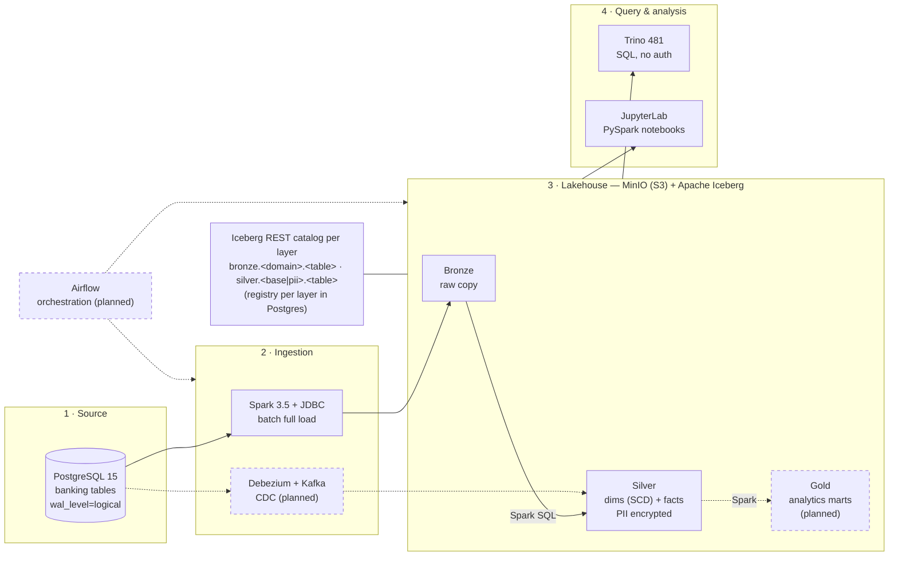

# LakeHouse_Banking

End-to-end banking lakehouse platform for transaction analytics, running locally on Docker Compose.

**Current status — Phase 1 (foundation):** the core stack (MinIO, Postgres, Spark, Iceberg REST, Trino, Jupyter) is up, and the first pipeline ingests banking source tables from Postgres into the **bronze** layer (Iceberg on MinIO, partitioned by business date `cob_dt`), then models them in the **silver** layer (dimensions with SCD1/2/3 history, facts, encrypted PII). Gold layer, CDC (Debezium) and orchestration are not built yet.

For day-to-day commands, see **[how_to_run.md](how_to_run.md)**.

---

## Data layers & tech stack

Solid lines = built, dashed = planned. Table-level flow and relationships: [data_dictionary.md](data_dictionary.md).



| Concern | Tool | Version | Status |
|---|---|---|---|
| Source databases | PostgreSQL 15 (alpine) + MySQL 8.4 LTS (`los_db`) | 15 / 8.4.13 | Built |
| Object storage | MinIO (S3-compatible) | 2025.5.24 | Built |
| Table format | Apache Iceberg (format v2, Parquet + Snappy) | 1.4.3 (Spark runtime) | Built |
| Catalog | One Iceberg REST catalog per layer: `bronze.<domain>.<table>`, `silver.<namespace>.<table>` (namespaces `base`, `pii`) in Spark and Trino; JDBC registry per layer in Postgres databases `iceberg_catalog_bronze`, `iceberg_catalog_silver` | tabulario 1.6.0 | Built |
| Processing / ingestion | Apache Spark standalone (PySpark, Python 3.8) | 3.5.0 | Built |
| SQL query engine | Trino (no authentication, plain HTTP) | 481 | Built |
| Notebooks | JupyterLab | 4.3.8 | Built |
| Change data capture | Debezium + Kafka | — | Planned |
| Orchestration | Apache Airflow | — | Planned |
| Runtime | Docker Compose (network `lakehouse-net-dungafk`) | — | Built |

## Architecture

Container-level view:

```
                         ┌──────────────────────── lakehouse-net-dungafk ────────────────────────┐
                         │                                                                        │
  Postgres 15            │   Spark 3.5.0 standalone                     MinIO (S3)                │
  (source DB)       ── JDBC ──►  master + worker  ── Iceberg (S3FileIO) ► bucket "lakehouse"     │
  crm, t24,              │      ▲                 ── s3a:// files ─────►  bucket "lab" (notebooks)│
  payment schemas        │      │                          │                    ▲                  │
                         │  spark-client (spark-submit)    ▼                    │                  │
                         │  jupyter (notebooks)      Iceberg REST catalog ──────┘                  │
                         │                           (registry in Postgres DB iceberg_catalog_bronze)     │
                         │                                 ▲                                       │
                         │                           Trino (SQL on Iceberg)                        │
                         └────────────────────────────────────────────────────────────────────────┘
```

## Services

| Container | Image | Role | Host port(s) |
|---|---|---|---|
| `minio-dungafk` | `bitnamilegacy/minio:2025.5.24` | S3-compatible object storage | 9000 (API), 9001 (console) |
| `minio-init-dungafk` | `bitnamilegacy/minio-client:2025.5.21` | One-shot: creates buckets `lakehouse` and `lab`, then exits | — |
| `postgres-dungafk` | `postgres:15-alpine` | Two databases: `POSTGRES_DB` = banking source data (`wal_level=logical`, ready for CDC); `ICEBERG_BRONZE_CATALOG_DB` / `ICEBERG_SILVER_CATALOG_DB` = Iceberg catalog registries | 5432 |
| `mysql-dungafk` | `mysql:8.4.13` (LTS, digest-pinned) | LOS source database `los_db` (`loan_product`, `loan_application`, `loan_contract`, `repayment`) | 3306 |
| `spark-master-dungafk` | `lakehouse-spark:3.5.0` (custom) | Spark standalone master | 8080 (UI), 7077 |
| `spark-worker-dungafk` | `lakehouse-spark:3.5.0` (custom) | Spark worker | 8081 |
| `spark-client-dungafk` | `lakehouse-jupyter:3.5.0-jlab4.3.8` (custom) | Idle container used to run `spark-submit` | 4040 (app UI) |
| `jupyter-dungafk` | `lakehouse-jupyter:3.5.0-jlab4.3.8` (custom) | JupyterLab with a "PySpark (Lakehouse)" kernel | 8888, 4041 |
| `iceberg-rest-bronze-dungafk` | `tabulario/iceberg-rest:1.6.0` | Iceberg REST catalog (catalog `bronze`, warehouse `s3://lakehouse/bronze/`) | 8181 |
| `iceberg-rest-silver-dungafk` | `tabulario/iceberg-rest:1.6.0` | Iceberg REST catalog (catalog `silver`, warehouse `s3://lakehouse/silver/`) | 8182 |
| `trino-dungafk` | `trinodb/trino:481` | SQL query engine over the Iceberg catalogs `bronze`, `silver` (no authentication) | 8086 (HTTP) |

Custom images:
- **`lakehouse-spark:3.5.0`** — `apache/spark:3.5.0` (Java 11, Scala 2.12, Python 3.8) + Iceberg 1.4.3 (`iceberg-spark-runtime`, `iceberg-aws-bundle`), `hadoop-aws` 3.3.4, AWS SDK bundle, Postgres, MySQL (Connector/J 8.4.0) and Oracle JDBC drivers.
- **`lakehouse-jupyter:3.5.0-jlab4.3.8`** — built on `lakehouse-spark:3.5.0` + JupyterLab 4.3.8, pandas, pyarrow, boto3, psycopg2, PyMySQL 1.1.1, oracledb. The startup script creates a `spark` session automatically in the PySpark kernel.

## Project structure

```
LakeHouse_Banking/
├── docker-compose.yml             # Whole Phase 1 stack
├── .env                           # Credentials, endpoints, resource limits (git-ignored, never commit)
├── .env.example                   # Committed template for .env
├── how_to_run.md                  # Command cheat sheet
├── data_dictionary.md             # Tables, columns, layers, data quirks
├── conf/
│   ├── spark-defaults.conf        # Mounted into every Spark container (Iceberg catalog, S3A, resources)
│   └── trino/                     # Trino config, catalog/bronze.properties + silver.properties (Iceberg REST)
├── docker/
│   ├── spark/                     # Dockerfile (Spark + Iceberg/S3/JDBC JARs)
│   └── jupyter/                   # Dockerfile, PySpark kernel, IPython startup script
├── init-sql/postgres/             # Source schema + seed data (runs on first Postgres start)
├── jobs/
│   ├── common/
│   │   ├── dates.py               # default_cob_dt (T-1), date_range, cob_dates, is_full_load, fill_window
│   │   ├── parsers.py             # CLI: parse_job_args (standard job options), parse_date, parse_where, add_date_options
│   │   ├── jdbc.py                # class Jdbc: all database access — Postgres read (JDBC) / connect (psycopg2),
│   │   │                          # Iceberg table creation (create_bronze_table, create_table), apply_schema
│   │   ├── load_patterns.py       # Write patterns: overwrite_partition (bronze), overwrite_where, append,
│   │   │                          # merge_upsert, scd1, scd2, scd3
│   │   └── pii.py                 # PII as Spark SQL: encrypt / decrypt (AES-GCM), keyed_hash, mask_*
│   ├── bronze/                    # Bronze jobs, one per table: <layer>__<domain>__<table>.py (generated from CSV)
│   │   ├── bronze_columns.py      # add_technical_columns() (cob_dt, _load_type, _source, _batch_id)
│   │   ├── crm/                   # bronze__crm__customer.py
│   │   ├── t24/                   # bronze__t24__account.py, bronze__t24__core_account.py, bronze__t24__transaction.py
│   │   ├── payment/               # bronze__payment__merchant_transaction.py
│   │   └── los/                   # bronze__los__loan_product.py, loan_application, loan_contract, repayment (MySQL)
│   ├── silver/                    # Silver YAML jobs + generic runner
│   │   ├── run_silver.py          # Generic runner: --job silver__<ns>__<table> [--cob-dt | --from-dt/--to-dt]
│   │   ├── base/                  # silver__base__dim_date.py (static calendar) + 5 YAML configs
│   │   │                          # (dim_party, dim_account, fact_account_balance, fact_transaction, fact_merchant_transaction)
│   │   └── pii/                   # 2 YAML configs: dim_party_identity (SCD1), dim_contact (SCD3) — encrypted
│   └── auto/                      # CSV-driven jobs (see "Pipeline: bronze ingestion")
│       ├── bronze_tables.csv      # Job list: source/target domain + table, load_type, event_col, filter, active
│       ├── bronze_columns.csv     # Columns to load per table: column_name, data_type (→ StructType SCHEMA)
│       ├── job_config.py          # Loads the two CSV files (after validation)
│       ├── validate/              # validate_config.py + rules.py (file checks) + source_checks.py (Postgres checks)
│       ├── run_domain.py          # Runs all active tables of one domain, one Spark app each, logs errors
│       ├── param/                 # Approach B
│       │   └── ingest_table.py    # One parameterised job (--domain --table)
│       └── generate/              # Approach A: code generators
│           ├── generate_bronze_job/
│           │   ├── generate_jobs.py   # Writes jobs/bronze/<domain>/bronze__<domain>__<table>.py per CSV row
│           │   └── templates/         # snapshot / incremental job templates
│           └── generate_sql/          # Reserved for a future SQL generator (empty)
├── logs/                          # Job logs, mounted at /home/spark/logs in spark-client (git-ignored)
├── known_issues/                  # Errors / data problems already met, cause + fix (read first when something breaks)
├── tuning/                        # Performance: baseline timings, optimizations with before → after times
└── notebooks/                     # Mounted into Jupyter at /opt/notebooks (empty)
```

`jobs/` is mounted at `/home/spark/jobs` in `spark-client-dungafk` and `jupyter-dungafk`.

## Source data (Postgres database `POSTGRES_DB` from `.env`)

Created by `init-sql/postgres/*.sql`, one schema per business domain (`public` is empty; the Iceberg catalog lives in the separate database `ICEBERG_BRONZE_CATALOG_DB`):

| Schema (domain) | Table | Rows | Description |
|---|---|---|---|
| `crm` | `customer` | 20 | Bank customers (segment RETAIL / PRIORITY / VIP) |
| `t24` | `account` | 200 | Accounts (CHECKING / SAVINGS / CREDIT) linked to `crm.customer` |
| `t24` | `transaction` | 10,000 | 2,000 transactions/day over the last 5 days, linked to `account` |
| `t24` | `core_account` | 7 | Core banking accounts — planned CDC source (upsert into Iceberg) |
| `payment` | `merchant_transaction` | 10 | Card payments at merchants — planned CDC source (aggregation) |

Column-level details, allowed values, bronze mapping and known data quirks: [data_dictionary.md](data_dictionary.md).

## Pipeline: bronze ingestion

Each Postgres source table has **its own job** `jobs/bronze/<domain>/bronze__<domain>__<table>.py` (naming rule
`<layer>__<domain>__<table>.py`) that copies it into an
**Iceberg** table `bronze.<domain>.<table>` (domains `crm`, `t24`, `payment`), **one partition per
business date `cob_dt`**. Each job keeps its own settings (source, target, `SCHEMA`, filter), command line and
`main()`; the repeated code is shared: database access (JDBC read, table creation) in class `Jdbc`
(`jobs/common/jdbc.py`), the partition write `overwrite_partition` in `jobs/common/load_patterns.py`, dates in
`jobs/common/dates.py`, options in `jobs/common/parsers.py`, technical columns in `jobs/bronze/bronze_columns.py`
(the same modules are used by `auto/param/ingest_table.py`). One job = one future Airflow task.

| Job | Source → bronze table |
|---|---|
| `jobs/bronze/crm/bronze__crm__customer.py` | `crm.customer` → `bronze.crm.customer` |
| `jobs/bronze/t24/bronze__t24__account.py` | `t24.account` → `bronze.t24.account` |
| `jobs/bronze/t24/bronze__t24__core_account.py` | `t24.core_account` → `bronze.t24.core_account` |
| `jobs/bronze/t24/bronze__t24__transaction.py` | `t24.transaction` → `bronze.t24.transaction` |
| `jobs/bronze/payment/bronze__payment__merchant_transaction.py` | `payment.merchant_transaction` → `bronze.payment.merchant_transaction` |
| `jobs/bronze/los/bronze__los__loan_product.py` | MySQL `los_db.loan_product` → `bronze.los.loan_product` |
| `jobs/bronze/los/bronze__los__loan_application.py` | MySQL `los_db.loan_application` → `bronze.los.loan_application` |
| `jobs/bronze/los/bronze__los__loan_contract.py` | MySQL `los_db.loan_contract` → `bronze.los.loan_contract` |
| `jobs/bronze/los/bronze__los__repayment.py` | MySQL `los_db.repayment` → `bronze.los.repayment` |

### CSV-driven jobs (`jobs/auto/`)

The jobs are defined in two CSV files in `jobs/auto/`:

- `bronze_tables.csv` — one row per job: `source_domain,source_table,target_domain,target_table,load_type,event_col,source_filter,active`
  (target names may differ from the source; `source_filter` is a fixed WHERE on the source);
- `bronze_columns.csv` — one row per column to load with its type (becomes the job's StructType).

Both files are checked by `jobs/auto/validate/validate_config.py` (also run by every tool before it starts); errors
point to [known_issues → Validate](known_issues/README.md#validate). Two ways to turn the files into jobs, both
producing the same bronze tables:

| | Approach B — parameterised (default) | Approach A — generated files (hand-over) |
|---|---|---|
| Folder | `auto/param/` | `auto/generate/` |
| Job code | One file `param/ingest_table.py --domain <d> --table <t>` | `generate/generate_bronze_job/generate_jobs.py` writes `jobs/bronze/<domain>/bronze__<domain>__<table>.py` per CSV row from `generate/generate_bronze_job/templates/` |
| Regenerate | Not needed | Every generator run rewrites the files and deletes the generated files of tables no longer in the CSV (hand-written files are kept) |
| Run a domain | `run_domain.py --domain <d> --cob-dt <date>` | `run_domain.py --domain <d> --mode generated --cob-dt <date>` |

`run_domain.py` runs the active tables of one domain one after another, **one Spark application per table** (as
Airflow will). A failed table does not stop the others; each failure is appended to **`logs/bronze/errors.log`** and the
full output of every run goes to `logs/bronze/runs/<domain>_<run_id>.log`. Commands: [how_to_run.md, section 3.1](how_to_run.md).

| Load type | Tables | What lands in partition `cob_dt` |
|---|---|---|
| snapshot | `customer`, `account`, `core_account` | Full copy of the table at run time |
| incremental | `transaction`, `merchant_transaction` | Rows whose event timestamp is on `cob_dt` |

- `cob_dt` is optional (`--cob-dt`, or `--from-dt/--to-dt` for a range); no date = **full load** (snapshot: T-1; incremental: whole source table, `cob_dt` = date of the event column, every partition present replaced; silver: every `cob_dt` of the bronze source). Re-running a date atomically replaces only that partition (idempotent).
- Every job declares the columns it loads and their bronze types up front as a **StructType `SCHEMA`** (one
  `StructField` per column; from `bronze_columns.csv` for the auto jobs) — remove a field to drop a column,
  change its type to cast it. It also loads a subset of rows: a fixed filter
  (`SOURCE_FILTER` / CSV `source_filter`) and, ad hoc, a **partial reload** `--where "<predicate>"` that replaces only the
  matching rows of a `cob_dt` partition.
- Incremental jobs: `source_filter` is the required date window (`{cob_dt}` / `{next_dt}`); the
  **first run** of an incremental job (table missing) is an **init** of the whole source table.
- Added columns: `cob_dt`, `_load_type`, `_source`, `_batch_id` (no `_row_hash` / `_ingested_at` since 2026-11-26: the run time is in `_batch_id`).
- Single pass (JDBC read → Iceberg write), no data validation in bronze (no row-count or duplicate-key checks; planned later).

Details: [data_dictionary.md, section 4](data_dictionary.md#4-bronze-layer). Commands: [how_to_run.md, section 3](how_to_run.md).

```powershell
docker exec -it spark-client-dungafk spark-submit /home/spark/jobs/bronze/crm/bronze__crm__customer.py --cob-dt 2026-11-23
```

## Pipeline: silver modelling

Silver jobs are defined as **one YAML file per table** (`jobs/silver/<namespace>/silver__<namespace>__<table>.yaml`)
executed by one generic runner **`jobs/silver/run_silver.py`** (`--job <job_code>` or `--config <path>`). Each YAML
declares `job_description` (metadata, upstream `job_parents`), `source` (`main_table`, optional `pipeline` temp views,
final Spark SQL with `{cob_dt}` / `{next_dt}` / `{pii.<fn>(<col>)}` placeholders) and `target` (`target_table`,
`write_mode`: `overwrite_partitions`, `append`, `scd1`, `scd2`, `scd3`). Exception: `dim_date` is a static calendar
script (`jobs/silver/base/silver__base__dim_date.py`). Catalog `silver`, namespaces `base` (no personal data) and `pii`
(encrypted).

| Table | Pattern (`write_mode`) | Source |
|---|---|---|
| `silver.base.dim_date` | full rebuild (Python script) | generated |
| `silver.base.dim_party` | `scd2`, `party_sk` auto-increment | `bronze.crm.customer` |
| `silver.base.dim_account` | `scd2`, `account_sk` auto-increment | `bronze.t24.account` |
| `silver.pii.dim_party_identity` | `scd1`, name / birth date encrypted | `bronze.crm.customer` |
| `silver.pii.dim_contact` | `scd3` (current + previous phone / email), encrypted | `bronze.crm.customer` |
| `silver.base.fact_account_balance` | `overwrite_partitions` (`cob_dt`) | `bronze.t24.account` |
| `silver.base.fact_transaction` | `overwrite_partitions` (`cob_dt`) | `bronze.t24.transaction` |
| `silver.base.fact_merchant_transaction` | `overwrite_partitions` (`cob_dt`) | `bronze.payment.merchant_transaction` |

- Run the dimensions before the facts (facts look up `account_sk` / `party_sk` valid on the fact date, `-1` = not found).
- PII: `jobs/common/pii.py` — `encrypt` / `decrypt` (AES-256-GCM), `keyed_hash` (compare without decrypting), `mask_*`.
- Re-running a date with the same data is idempotent (`scd1/2/3` writes 0 rows; `overwrite_partitions` atomically replaces the `cob_dt` partition); SCD2 dates must be loaded in order.
- No data-quality checks yet (planned later).

Details: [data_dictionary.md, section 5](data_dictionary.md#5-silver-layer). Commands: [how_to_run.md, section 4](how_to_run.md).

## Quick start

```powershell
Copy-Item .env.example .env                 # then edit the credentials in .env
docker compose build spark-master-dungafk   # build the Spark image first
docker compose build jupyter-dungafk        # Jupyter image is based on it
docker compose up -d
docker exec -it spark-client-dungafk spark-submit /home/spark/jobs/bronze/crm/bronze__crm__customer.py --cob-dt 2026-11-23   # one bronze job; see how_to_run.md §3
```

Then open the Spark UI (http://localhost:8080), MinIO console (http://localhost:9001) or JupyterLab (http://localhost:8888).

## Configuration notes

- All values in `.env` are **local-lab defaults** — not for real environments.
- Spark resources per application (`conf/spark-defaults.conf`): 1 executor × 1 core, 768m + 256m overhead, so a notebook and a `spark-submit` can run side by side. Pass `--conf spark.cores.max=N` for more parallelism.
- S3A reads MinIO credentials from `AWS_ACCESS_KEY_ID` / `AWS_SECRET_ACCESS_KEY` (set by docker-compose from `.env`); Iceberg S3FileIO requires `AWS_REGION` even for MinIO.
- PII in silver is encrypted with `PII_ENCRYPTION_KEY` and hashed with `PII_HASH_KEY` (`.env`). Losing the encryption key makes `silver.pii.*` unreadable — it is also kept in the credentials Excel.
- The Iceberg catalog registry (`iceberg_tables`, `iceberg_namespace_properties`) is stored in its own Postgres database per layer: `ICEBERG_BRONZE_CATALOG_DB` (default `iceberg_catalog_bronze`), `ICEBERG_SILVER_CATALOG_DB` (`iceberg_catalog_silver`), created by `init-sql/postgres/00_create_iceberg_catalog_db.sh`), separate from the banking source data, so tables survive container restarts and CDC on the source DB never sees catalog commits. Never edit these tables by hand — all changes go through Spark / Trino.

## Known issues / limitations

Errors already met and how they were fixed: **[known_issues/](known_issues/README.md)**.
Performance baseline and optimizations (before → after times): **[tuning/](tuning/README.md)**.

- The Spark worker has no container memory limit (`.env`: `SPARK_WORKER_MEM=8g`, `SPARK_WORKER_CORES=10`, `SPARK_WORKER_MEM_LIMIT` commented out); fine only if the machine has the resources.
- `init-sql/` scripts only run when the Postgres volume is empty. Re-running them manually duplicates data (see [how_to_run.md](how_to_run.md#9-re-seed-the-postgres-source-data)).
- JupyterLab runs without a token and Trino without authentication — local use only.

## Roadmap

- [x] Phase 1 stack: MinIO, Postgres, Spark, Iceberg REST, Trino, Jupyter
- [x] Bronze ingestion Postgres → Iceberg on MinIO (snapshot / incremental / full load, CSV-driven jobs)
- [x] Silver layer: YAML job configs + generic runner `run_silver.py` (dims SCD1/2/3, facts `overwrite_partitions`, encrypted PII)
- [ ] Data-quality checks (bronze / silver)
- [ ] Gold layer: transaction analytics marts
- [ ] CDC with Debezium on `core_account` / `merchant_transaction`
- [ ] Orchestration and scheduling
