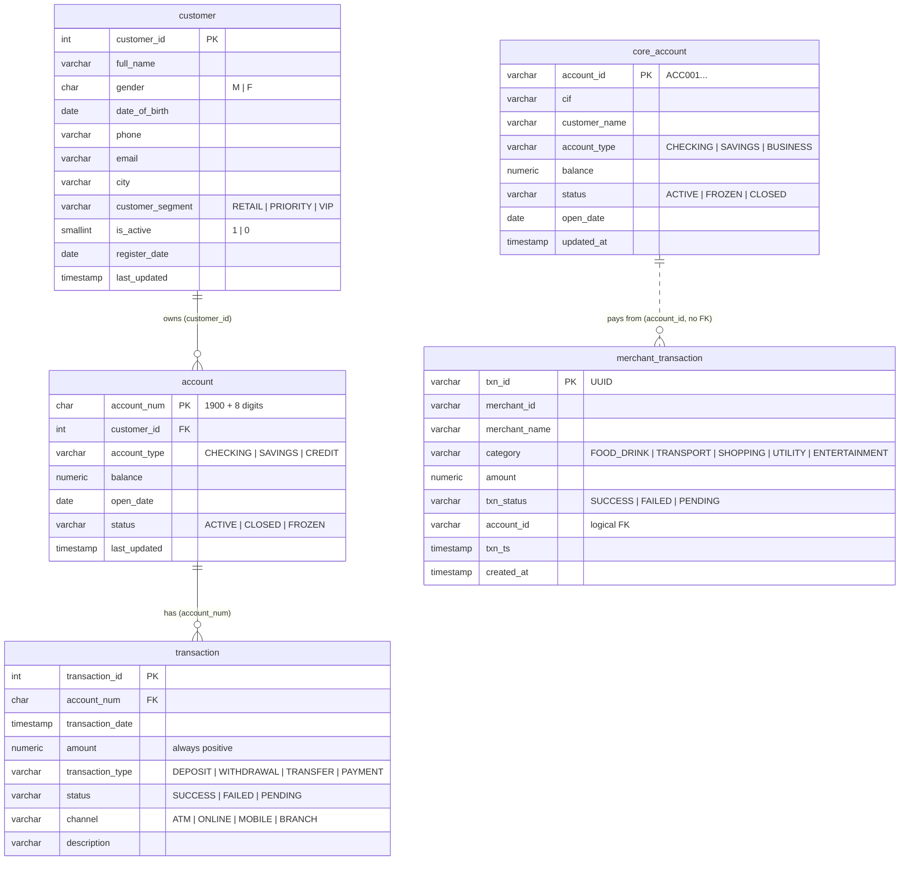

# Data Dictionary — LakeHouse_Banking

Describes every dataset the lakehouse uses: source tables in Postgres, how they land in the bronze layer,
known data quirks, and (later) silver / gold models. This is the single reference for "what does this column mean".

- **Maintenance:** any change to the data (new table/column, changed allowed values, new seed logic, new layer)
  is reflected here in the same change, and a line is added to the [Change log](#8-change-log).
- **Source of truth for schemas:** `init-sql/postgres/*.sql` (source) and `jobs/` (lakehouse layers).
  If this document and the code disagree, the code wins — fix the document.

---

## 1. Overview

| Layer | Location | Status |
|---|---|---|
| Source | Postgres database `${POSTGRES_DB}` (container `postgres-dungafk`), one schema per business domain: `crm`, `core_banking`, `payment` | Done |
| Bronze | Iceberg `lakehouse.bronze_<domain>.<table>`, one partition per business date `cob_dt` | Job ready, no data loaded yet |
| Silver | Not designed yet | Planned |
| Gold | Not designed yet (transaction analytics marts) | Planned |

**Source schemas (business domains).** Each Postgres schema is one domain, and the bronze layer keeps the same split
(Iceberg namespace `bronze_<domain>`, files under `s3://lakehouse/bronze_<domain>/`). The `public` schema is empty.
The Iceberg REST catalog tables (`iceberg_tables`, `iceberg_namespace_properties`) live in a **separate database**
`ICEBERG_CATALOG_DB` (default `iceberg_catalog`) on the same Postgres server — lakehouse metadata, not business data.

| Schema (domain) | Tables | Business meaning |
|---|---|---|
| `crm` | `customer` | Customer master data |
| `core_banking` | `account`, `transaction`, `core_account` | Accounts and account transactions (retail + core banking) |
| `payment` | `merchant_transaction` | Card / wallet payments at merchants |

**Data lineage groups.** Independently of the schemas, the tables form **two groups that are *not* linked by any key**:

| Group | Tables | Purpose |
|---|---|---|
| **A. Retail banking (batch)** | `crm.customer` → `core_banking.account` → `core_banking.transaction` | Main batch pipeline: bronze → silver → gold |
| **B. Core / merchant (CDC)** | `core_banking.core_account`, `payment.merchant_transaction` | Future Debezium CDC sources: upsert (`core_account`) and aggregate (`merchant_transaction`) cases |

### 1.1 Data flow through the layers

Solid lines = built, dashed lines / dashed boxes = planned (design not decided yet).

```mermaid
flowchart LR
    subgraph SRC["Source — Postgres 15 (schemas crm / core_banking / payment)"]
        direction TB
        s_cust[crm.customer]
        s_acc[core_banking.account]
        s_txn[core_banking.transaction]
        s_core[core_banking.core_account]
        s_mt[payment.merchant_transaction]
    end

    subgraph BRZ["Bronze (Iceberg) — raw copy + cob_dt + technical columns"]
        direction TB
        b_cust["bronze_crm.customer<br/>daily snapshot"]
        b_acc["bronze_core_banking.account<br/>daily snapshot"]
        b_txn["bronze_core_banking.transaction<br/>incremental by transaction_date"]
        b_core["bronze_core_banking.core_account<br/>daily snapshot"]
        b_mt["bronze_payment.merchant_transaction<br/>incremental by txn_ts"]
    end

    subgraph SLV["Silver — cleansed, typed, deduplicated (planned)"]
        direction TB
        sv_a["Group A<br/>customer / account / transaction"]
        sv_b["Group B<br/>core_account (upsert)"]
    end

    subgraph GLD["Gold — analytics marts (planned)"]
        direction TB
        g_txn["Transaction analytics marts"]
        g_mer["Merchant revenue aggregates"]
    end

    s_cust -->|"Spark JDBC<br/>per cob_dt"| b_cust
    s_acc --> b_acc
    s_txn --> b_txn
    s_core --> b_core
    s_mt --> b_mt

    b_cust -.-> sv_a
    b_acc -.-> sv_a
    b_txn -.-> sv_a
    b_core -.-> sv_b
    sv_a -.-> g_txn

    s_core -.->|"Debezium CDC<br/>upsert"| sv_b
    s_mt -.->|"Debezium CDC<br/>aggregate"| g_mer

    classDef planned stroke-dasharray: 5 5
    class SLV,GLD,sv_a,sv_b,g_txn,g_mer planned
```

### 1.2 Table relationships (source)

`||--o{` = one-to-many with a real foreign key; `||..o{` = logical link only (no FK constraint in Postgres).
Schemas: `customer` is in `crm`; `account`, `transaction`, `core_account` in `core_banking`; `merchant_transaction` in `payment`.
The `account → customer` FK crosses schemas (`core_banking.account.customer_id` → `crm.customer.customer_id`).

There is **no link between domain A and domain B** (`core_account.account_id` ≠ `account.account_num`).

---

## 2. Group A — Retail banking (`crm`, `core_banking`)

### 2.1 `crm.customer`

One row per bank customer. Script: `init-sql/postgres/01_seed_customer.sql`.

| Column | Type | Null | Key | Allowed values / rule | Description |
|---|---|---|---|---|---|
| `customer_id` | SERIAL (int) | NO | PK | 1..20 | Surrogate customer ID |
| `full_name` | VARCHAR(200) | NO | | Vietnamese, with diacritics | Customer full name (PII) |
| `gender` | CHAR(1) | NO | | `M`, `F` | Gender |
| `date_of_birth` | DATE | NO | | 1970–1998 in seed | Date of birth (PII) |
| `phone` | VARCHAR(15) | YES | | 10-digit VN mobile | Phone number (PII) |
| `email` | VARCHAR(200) | YES | | | Email (PII) |
| `city` | VARCHAR(100) | YES | | TP.HCM, Hà Nội, Đà Nẵng, Hải Phòng, Cần Thơ | City of residence |
| `customer_segment` | VARCHAR(20) | NO | | `RETAIL`, `PRIORITY`, `VIP` | Customer tier |
| `is_active` | SMALLINT | NO | | `1` = active, `0` = inactive (default 1) | Active flag |
| `register_date` | DATE | NO | | 2016–2023 in seed | Date the customer joined the bank |
| `last_updated` | TIMESTAMP | NO | | default `NOW()` | Last change time (see quirks) |

**Seed:** 20 fixed rows (hand-written). 1 inactive customer (`Mai Thị Thu`).

### 2.2 `core_banking.account`

One row per bank account; a customer has many accounts. Script: `02_seed_account.sql`.

| Column | Type | Null | Key | Allowed values / rule | Description |
|---|---|---|---|---|---|
| `account_num` | CHAR(12) | NO | PK | `'1900'` + 8 digits | Account number |
| `customer_id` | INTEGER | NO | FK → `crm.customer.customer_id` | | Account owner |
| `account_type` | VARCHAR(20) | NO | | `CHECKING`, `SAVINGS`, `CREDIT` | Product type |
| `balance` | NUMERIC(15,2) | NO | | 0 – 500,000,000 (VND), default 0 | Current balance |
| `open_date` | DATE | NO | | within the last 5 years before seed date | Account open date |
| `status` | VARCHAR(10) | NO | | `ACTIVE`, `CLOSED`, `FROZEN` | Account status |
| `last_updated` | TIMESTAMP | NO | | default `NOW()` | Last change time |

**Seed:** 200 rows, round-robin over customers → **10 accounts per customer**.
`account_type`, `balance`, `open_date` are random; `status` is random with weights ACTIVE ≈ 4/6, CLOSED ≈ 1/6, FROZEN ≈ 1/6.

### 2.3 `core_banking.transaction`

One row per account transaction. Script: `03_seed_transaction.sql`. Index on `transaction_date`.

| Column | Type | Null | Key | Allowed values / rule | Description |
|---|---|---|---|---|---|
| `transaction_id` | SERIAL (int) | NO | PK | 1..10000 | Transaction ID |
| `account_num` | CHAR(12) | NO | FK → `core_banking.account.account_num` | | Account the transaction belongs to |
| `transaction_date` | TIMESTAMP | NO | | T-1 … T-5 (relative to seed date), random time of day | Transaction time |
| `amount` | NUMERIC(15,2) | NO | | 10,000 – 50,000,000 (VND), always positive | Transaction amount |
| `transaction_type` | VARCHAR(20) | NO | | `DEPOSIT`, `WITHDRAWAL`, `TRANSFER`, `PAYMENT` | Transaction type |
| `status` | VARCHAR(10) | NO | | `SUCCESS`, `FAILED`, `PENDING` | Result (weights SUCCESS ≈ 4/6, FAILED ≈ 1/6, PENDING ≈ 1/6) |
| `channel` | VARCHAR(10) | NO | | `ATM`, `ONLINE`, `MOBILE`, `BRANCH` | Channel used |
| `description` | VARCHAR(255) | YES | | `GD-D<day_offset>-<nnnn>` | Free text (seed: synthetic code) |

**Seed:** 2,000 rows/day × 5 days = **10,000 rows**, spread evenly → **50 transactions per account**.
There is no `last_updated` column — the table is append-only by design.

---

## 3. Group B — Core account & merchant, CDC sources (`core_banking`, `payment`)

### 3.1 `core_banking.core_account`

Core-banking account snapshot; future CDC **upsert** source (Debezium → Iceberg MERGE). Script: `04_core_account.sql`.

| Column | Type | Null | Key | Allowed values / rule | Description |
|---|---|---|---|---|---|
| `account_id` | VARCHAR(20) | NO | PK | `ACC001`… | Core account ID |
| `cif` | VARCHAR(15) | NO | | `CIF001`… | Customer Information File number |
| `customer_name` | VARCHAR(100) | NO | | unaccented Vietnamese | Customer name (PII) |
| `account_type` | VARCHAR(20) | NO | | `CHECKING`, `SAVINGS`, `BUSINESS` (no CHECK constraint) | Product type |
| `balance` | NUMERIC(18,2) | NO | | default 0 | Current balance (VND) |
| `status` | VARCHAR(10) | NO | | `ACTIVE`, `FROZEN`, `CLOSED` (no CHECK constraint), default `ACTIVE` | Account status |
| `open_date` | DATE | NO | | default `CURRENT_DATE` | Open date |
| `updated_at` | TIMESTAMP | NO | | default `NOW()` | Last change time |

**Seed:** 7 fixed rows (`ACC001`–`ACC007`), 1 `FROZEN` (`ACC005`).

### 3.2 `payment.merchant_transaction`

Card / wallet payments at merchants; future CDC **aggregate** source (e.g. revenue per merchant/category). Script: `05_merchant_transaction.sql`.

| Column | Type | Null | Key | Allowed values / rule | Description |
|---|---|---|---|---|---|
| `txn_id` | VARCHAR(36) | NO | PK | UUID, default `gen_random_uuid()` | Transaction ID |
| `merchant_id` | VARCHAR(20) | NO | | `MER001`… | Merchant ID |
| `merchant_name` | VARCHAR(100) | NO | | | Merchant name (denormalized) |
| `category` | VARCHAR(30) | NO | | `FOOD_DRINK`, `TRANSPORT`, `SHOPPING`, `UTILITY`, `ENTERTAINMENT` (no CHECK) | Merchant category |
| `amount` | NUMERIC(18,2) | NO | | positive (VND) | Payment amount |
| `txn_status` | VARCHAR(10) | NO | | `SUCCESS`, `FAILED`, `PENDING` (no CHECK) | Result |
| `account_id` | VARCHAR(20) | NO | logical → `core_banking.core_account.account_id` (no FK, cross-schema) | | Paying account |
| `txn_ts` | TIMESTAMP | NO | | default `NOW()` | Business time of the payment |
| `created_at` | TIMESTAMP | NO | | default `NOW()` | Row insert time |

**Seed:** 10 rows, `txn_ts` within the last 3 hours before seed time; 6 merchants (`MER001`–`MER006`); 1 `FAILED`.

---

## 4. Bronze layer

Produced by **one self-contained job per table**, `jobs/bronze/<domain>/ingest_<table>.py`. The only shared code is
`add_technical_columns()` in `jobs/bronze/bronze_columns.py` (section 4.3) and the argument parsers in `jobs/common/parsers.py`. The CSV-driven jobs in
`jobs/bronze/auto/` (table list `bronze_jobs.csv`; parameterised `auto/param/ingest_table.py` or generated files in
`auto/generate/generated/`) write the same tables with the same columns and load strategy.
Storage: **Iceberg only** (format v2, Snappy Parquet), `s3://lakehouse/bronze_<domain>/<table>/`, queryable from Trino.

### 4.1 Load strategy

Every run loads **one business date `cob_dt`** (close-of-business date) and replaces exactly that partition
(Iceberg overwrite by filter `cob_dt = <date>`): re-running a date is idempotent, other dates are never touched,
and an empty load clears the partition. Default `cob_dt` = **yesterday in Vietnam time (UTC+7)**; any date can be
passed with `--cob-dt`. Incremental jobs also accept a range `--from-dt/--to-dt` (backfill, one partition per day);
snapshot jobs do not, because a snapshot can only capture the table as it is at run time.

| Load type | Meaning | Source query |
|---|---|---|
| `snapshot` | Copy of the source table as it is **at run time**, tagged with `cob_dt` | `SELECT <columns> FROM <schema>.<table> [WHERE <source_filter>]` |
| `incremental` | Only the rows whose event timestamp falls on `cob_dt` | `… WHERE <event_col> >= cob_dt AND <event_col> < cob_dt + 1 [AND <source_filter>]` (filtered in Postgres) |

**Subsets of columns and rows** (all job kinds: hand-written constants, CSV columns for the auto jobs):

| Setting | Effect |
|---|---|
| `SCHEMA` / CSV `columns` | StructType declaring the columns to load and their bronze types (CSV: `name:type\|...`). Only these columns are selected in Postgres and each is cast to its declared type; bronze then has exactly these columns (+ technical columns). `None` / empty = all source columns with their source types. The current jobs declare all columns with the types bronze already had (section 4.4), so nothing changed for existing tables |
| `SOURCE_FILTER` / CSV `source_filter` | **Fixed filter** (case 1): applied on every run, so each `cob_dt` partition always holds exactly the filtered set |
| `--where "
"` | **Partial reload** (case 2, ad hoc): only the source rows matching `
` (and the fixed filter) are read; in the `cob_dt` partition the rows matching `
` are replaced by them, all other rows are kept. One atomic Iceberg commit: the kept rows and the new rows overwrite the partition together. Rows matching `
` that no longer exist in the source disappear from the partition |

`_source_filter` (section 4.3) records which predicate produced each row. Predicates must be valid in both Postgres and
Spark SQL (`--where` is also evaluated on the bronze table, so its columns must be loaded columns).
Target table names may differ from the source table (auto jobs: CSV `source_table` / `target_table`).

### 4.2 Jobs (one job = one table)

Domains follow the source schemas; the Iceberg namespace is flat (`bronze_<domain>`, not nested `bronze.<domain>`)
because Trino does not handle nested namespaces well. Job files are under `jobs/bronze/<domain>/ingest_<table>.py`.

| Domain | Table | Source | Bronze table | Load type | Event column | Primary key |
|---|---|---|---|---|---|---|
| `crm` | `customer` | `crm.customer` | `lakehouse.bronze_crm.customer` | snapshot | — | `customer_id` |
| `core_banking` | `account` | `core_banking.account` | `lakehouse.bronze_core_banking.account` | snapshot | — | `account_num` |
| `core_banking` | `core_account` | `core_banking.core_account` | `lakehouse.bronze_core_banking.core_account` | snapshot | — | `account_id` |
| `core_banking` | `transaction` | `core_banking.transaction` | `lakehouse.bronze_core_banking.transaction` | incremental | `transaction_date` | `transaction_id` |
| `payment` | `merchant_transaction` | `payment.merchant_transaction` | `lakehouse.bronze_payment.merchant_transaction` | incremental | `txn_ts` | `txn_id` |

Why: master data (`customer`, `account`, `core_account`) is small, updated in place and has no reliable change
timestamp (no trigger on `last_updated` / `updated_at`), so a daily snapshot is the only safe way to capture changes.
Event data (`transaction`, `merchant_transaction`) is append-only and large, so only the day's events are loaded.
Bronze does **no data validation**: each job reads the source once and writes it (no cache, no row-count comparison,
no duplicate-key check). Duplicated keys, if any, are kept as is; validation and deduplication come later (silver / a
separate data-quality step, not designed yet).

### 4.3 Columns added to every bronze table

All source columns are kept 1:1 and come first; these columns are appended:

| Column | Type | Description |
|---|---|---|
| `cob_dt` | date | **Business date of the load** (close of business). Partition column (identity). Snapshot: the date the snapshot represents; incremental: the event date. |
| `_load_type` | string | `snapshot` or `incremental` |
| `_source` | string | `postgres.<schema>.<table>`, e.g. `postgres.core_banking.account` |
| `_batch_id` | string | `<table>_<cob_dt yyyymmdd>_<run start UTC yyyymmddThhmmss>`, e.g. `customer_20261120_20261124T055502` — identifies the run that wrote the row |
| `_ingested_at` | timestamp with time zone | Time the row was written |
| `_source_filter` | string | WHERE predicate applied to the source for this row: the fixed `source_filter` and/or the `--where` of a partial reload, joined with `AND`, e.g. `(status IN ('ACTIVE', 'FROZEN')) AND (account_num IN ('190012393455'))`. **NULL = full table / full day** (no filter). Added 2026-11-24; tables created earlier get it on their next write (`mergeSchema`) |
| `_row_hash` | string | SHA-256 (hex) of all loaded source columns (`sha2(to_json(struct(*)))`). Same row content → same hash on every `cob_dt`, so silver can detect changes (e.g. SCD2) without comparing every column. |

### 4.4 Type mapping (Postgres → Iceberg / Trino)

`SERIAL/INTEGER` → integer, `VARCHAR/CHAR` → varchar, `NUMERIC(p,s)` → decimal(p,s), `DATE` → date,
`TIMESTAMP` → **timestamp(6) without time zone** (read with JDBC `preferTimestampNTZ=true`, so values are kept exactly
as in Postgres and are not shifted by the Spark session time zone). Check with `DESCRIBE lakehouse.bronze_<domain>.<table>` in Trino.

### 4.5 Schema changes

New source columns are added to the bronze table automatically (`write.spark.accept-any-schema` + `mergeSchema`).
Renamed / dropped / retyped source columns are not handled automatically — update the table by hand and note it here.

---

## 5. Silver layer

_Not designed yet._

Decided:
- Input: **bronze Iceberg** tables `lakehouse.bronze_<domain>.<table>`, read by `cob_dt` partition
  (bronze is Iceberg only since 2026-11-24).

Open decisions (to be filled in when made):
- Load strategy per table: rebuild from the latest snapshot vs. incremental by `cob_dt`; history (SCD2) for
  master data using `_row_hash`.
- Planned scope: cleansing, typing, deduplication.
- Note: a snapshot partition for a past `cob_dt` written by a backfill holds the table state **at run time**, not the
  real state on that date — history before the first daily run is not reliable.

## 6. Gold layer

_Not designed yet._ Planned: transaction analytics marts.

---

## 7. Known quirks & data-quality notes

Keep in mind when designing silver / gold:

1. **Groups A and B are unrelated.** `core_account.account_id` (`ACC001`) does not match `account.account_num`
   (`1900…`), and `cif` / `customer_name` do not link to `customer`. Names in `core_account` are unaccented.
2. **Dates are relative to the seed time.** `account.open_date`, `transaction.transaction_date` and
   `merchant_transaction.txn_ts` are computed from `CURRENT_DATE` / `NOW()` when the Postgres volume was first
   initialised, so they shift each time the stack is reset.
3. **Seed values are random** (`random()`): account types, balances, statuses, transaction amounts differ after every reset.
   Row counts and key distribution (10 accounts/customer, 50 transactions/account) are deterministic.
4. **`last_updated` / `updated_at` are not maintained automatically** — there is no trigger; they only hold the
   insert time unless the writer sets them. They are not reliable watermarks for incremental loads yet.
5. **`amount` is always positive** in `transaction`; direction must be derived from `transaction_type`
   (`DEPOSIT` = inflow; `WITHDRAWAL`, `TRANSFER`, `PAYMENT` = outflow).
6. **Transactions on non-active accounts:** seed data assigns transactions to `CLOSED` / `FROZEN` accounts too.
7. **`balance` is not derived from transactions** — balances and transaction amounts are generated independently.
8. **Group B has no CHECK constraints** on `account_type`, `status`, `category`, `txn_status` — silver must validate them.
9. **`is_active` is SMALLINT 0/1**, not boolean — cast in silver.
10. **PII:** `full_name`, `date_of_birth`, `phone`, `email`, `customer_name` are personal data (synthetic here).
    Sample emails use real domains (`@gmail.com`, `@yahoo.com`).
11. **Snapshot backfill is not historical.** A snapshot task run for an old `cob_dt` stores the source as it is *now*,
    not as it was on that date (Postgres keeps no history). Only snapshots taken on the day are true point-in-time copies.
12. **Timestamps are local time without time zone** in Postgres. Bronze keeps them as `timestamp` (no zone); never read
    them as `timestamp with time zone` in Spark, or late-evening rows shift to the next date (+7h).
13. **Incremental dates follow the seed.** `transaction` only has rows on the 5 days before the seed date and
    `merchant_transaction` only on the seed date, so most other `cob_dt` values load 0 rows for these tables.

---

## 8. Change log

| Date | Change |
|---|---|
| 2026-11-24 | Document created from `init-sql/postgres/01–05` and `jobs/ingest_data/ingest_minio.py`. Row counts taken from seed scripts (Docker was not running; not yet checked against the live DB). |
| 2026-11-24 | Added Mermaid diagrams: data flow through layers (1.1) and full table relationship diagram (1.2). |
| 2026-11-24 | **Source split into domain schemas**: `crm` (customer), `core_banking` (account, transaction, core_account), `payment` (merchant_transaction); `public` keeps only the Iceberg catalog tables. New `init-sql/postgres/00_create_schemas.sql`; seeds use qualified names. Live DB migrated with `ALTER TABLE … SET SCHEMA` (no data loss, row counts 20/200/10000/7/10 verified). **Bronze split by domain**: Parquet `s3a://lab/bronze/<domain>/<table>/`, Iceberg `lakehouse.bronze_<domain>.<table>`; `_source` = `postgres.<schema>.<table>`. Old `bronze/<table>` Parquet folders and `lakehouse.bronze.*` Iceberg tables were deleted. |
| 2026-11-24 | **Iceberg catalog moved to its own database** `iceberg_catalog` (`ICEBERG_CATALOG_DB` in `.env`), separate from the banking source DB. `iceberg_tables` / `iceberg_namespace_properties` copied with `pg_dump` (5 tables, 6 namespace properties, identical md5); `iceberg-rest` now points at the new DB. New init script `init-sql/postgres/00_create_iceberg_catalog_db.sh`. Old copies in the source DB's `public` schema dropped after verification — `public` is now empty. |
| 2026-11-24 | **Bronze rebuilt with `cob_dt`**: new job `jobs/bronze/ingest_bronze.py` + task registry `jobs/bronze/bronze_tables.py`, Iceberg only, partition `cob_dt` (default D-1, UTC+7), overwrite-by-partition. Snapshot load for `customer`, `account`, `core_account`; incremental by event date for `transaction`, `merchant_transaction`. New columns `cob_dt`, `_load_type`, `_batch_id`, `_row_hash` (kept `_source`, `_ingested_at`); timestamps read as TIMESTAMP_NTZ (fixes a +7h date shift). Plain-Parquet bronze (`s3a://lab/bronze/`) and `partition_date` dropped. |
| 2026-11-24 | Cut-over: old bronze (Iceberg tables without `cob_dt`, Parquet `s3a://lab/bronze/`), test tables and `jobs/ingest_data/ingest_minio.py` deleted. Lakehouse is empty; no backfill run yet. |
| 2026-11-24 | Docs cleanup: section 1 no longer mentions Parquet bronze folders; section 5 records that silver reads bronze Iceberg and notes that backfilled snapshot partitions hold run-time state. No data change. |
| 2026-11-24 | **One bronze job per table**: `jobs/bronze/<domain>/ingest_<table>.py` (5 jobs) + shared `jobs/bronze/bronze_lib.py`; new option `--namespace-prefix` for test runs. Same load strategy, partitioning and columns as before. The all-tables job moved to `jobs/bronze/auto/` (parked). Tested on the cluster in `test_bronze_*` namespaces (row counts 20/200/7, transaction 2,000/day for 11-16..11-20, merchant_transaction 10 on 11-21, idempotent re-run), test namespaces dropped. |
| 2026-11-24 | **Bronze jobs made fully standalone** (user request): each `jobs/bronze/<domain>/ingest_<table>.py` has its own source query, write, checks and command line; the only shared code is `add_technical_columns()` in the new `jobs/bronze/bronze_columns.py`. `jobs/bronze/bronze_lib.py` deleted. Snapshot jobs no longer accept `--from-dt/--to-dt`. Same load strategy, partitioning and columns; tested in `test_bronze_*` (20/200/7 rows, transaction 2,000/day 11-16..11-20, merchant_transaction 10 on 11-21, idempotent re-run, `_row_hash` equal to the live bronze rows), test namespaces dropped. |
| 2026-11-24 | Bronze jobs simplified (user request): duplicate-key check, `cache()` and source-vs-bronze row-count check removed — one JDBC read, one Iceberg write per `cob_dt`; `PRIMARY_KEY` constant dropped from the jobs (keys stay documented in 4.2). Validation will be designed separately. Tested in `test_bronze_*` (counts checked from Trino outside the jobs: 20/200/7, transaction 2,000/day, merchant_transaction 10), dropped afterwards. |
| 2026-11-24 | **CSV-driven bronze jobs** in `jobs/bronze/auto/`: table list `bronze_jobs.csv` (`domain,table,load_type,event_col,active`, validated by `job_config.py`); approach B `ingest_table.py --domain --table`; approach A `generate_jobs.py` → `auto/generated/<domain>/ingest_<table>.py` from `auto/templates/` (folder wiped on every run); `run_domain.py` runs a domain table by table, one Spark app each, failures to `logs/bronze/errors.log`. Old `auto/ingest_bronze.py` + `auto/bronze_tables.py` replaced. Same tables, columns, load strategy. Tested in `test_bronze_*` with both approaches (all 5 tables, backfill skips snapshot tables, failing table logged and the next table still ran), test data and logs removed. |
| 2026-11-24 | **Column / row subsets and partial reload** for all bronze jobs (hand-written, auto/param, auto/generate): `COLUMNS` / CSV `columns` (subset of columns), `SOURCE_FILTER` / CSV `source_filter` (fixed WHERE, case 1), `--where` partial reload (case 2: replace only matching rows of a `cob_dt` partition, one atomic commit). New technical column `_source_filter` (NULL = no filter). CSV is now `domain,source_table,target_table,load_type,event_col,columns,source_filter,active` (target name may differ from the source); hand-written job constant `TABLE` renamed `TARGET_TABLE`. Real CSV rows unchanged in meaning (no filter, all columns, same names). Tested in `test_bronze_*` incl. renamed targets, column subsets, filters (counts equal to Postgres: 19 / 170 / 9) and partial reloads; test tables dropped. |
| 2026-11-24 | **Explicit StructType schema** in every bronze job: `COLUMNS` replaced by `SCHEMA` (one `StructField` per column, cast after the JDBC read); CSV `columns` is now `name:type|...` (quoted cell). The 5 jobs and the CSV declare all columns with the types bronze already had (int, string, date, decimal(15,2)/(18,2), timestamp_ntz), so existing tables are unchanged — verified by comparing DESCRIBE of test tables (all 3 job kinds) with the live bronze tables. A custom schema test (subset + casts to double / string) worked; test tables dropped. |
