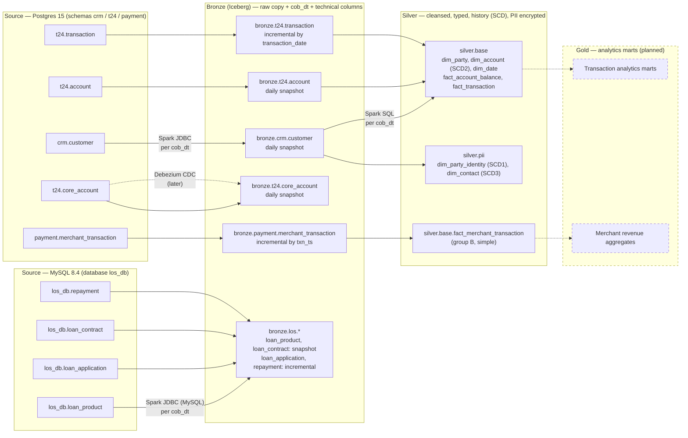
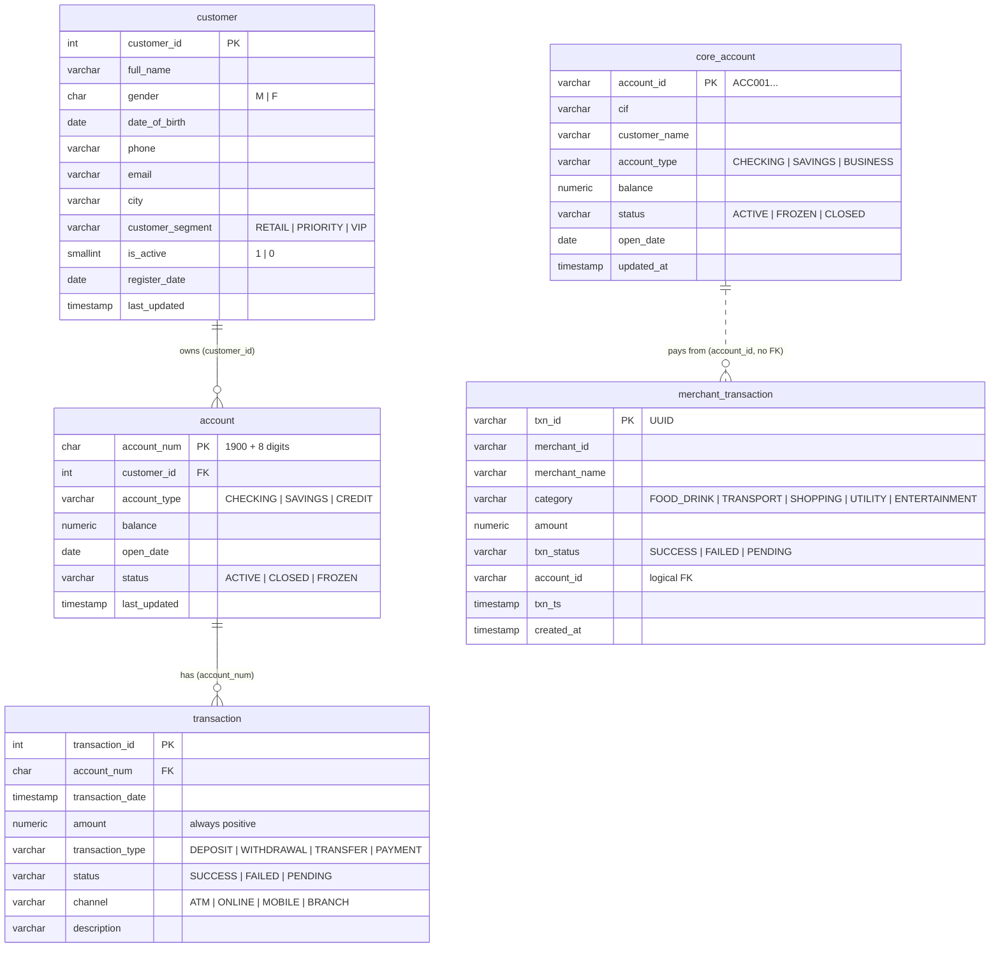
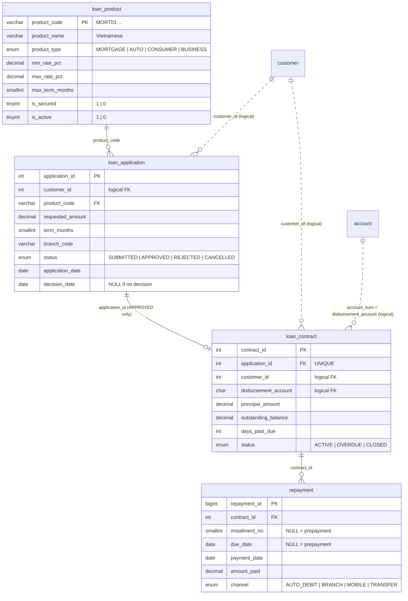

# Data Dictionary — LakeHouse_Banking

Describes every dataset the lakehouse uses: source tables in Postgres and MySQL, how they land in the bronze layer,
known data quirks, and (later) silver / gold models. This is the single reference for "what does this column mean".

- **Maintenance:** any change to the data (new table/column, changed allowed values, new seed logic, new layer)
  is reflected here in the same change, and a line is added to the [Change log](#8-change-log).
- **Source of truth for schemas:** `init-sql/postgres/*.sql` and `init-sql/mysql/*.sql` (sources) and `jobs/`
  (lakehouse layers).
  If this document and the code disagree, the code wins — fix the document.

---

## 1. Overview

| Layer | Location | Status |
|---|---|---|
| Source | Postgres database `${POSTGRES_DB}` (container `postgres-dungafk`), one schema per business domain: `crm`, `t24`, `payment` | Done |
| Source | MySQL 8.4 database `los_db` (container `mysql-dungafk`): domain `los`, loan origination system | Done (seeded 2026-11-27) |
| Bronze | Iceberg `bronze.<domain>.<table>` (catalog `bronze`), one partition per business date `cob_dt` | Loaded (`crm`, `t24`, `payment`, `los` — all 9 tables loaded and verified 2026-11-27) |
| Silver | Iceberg `silver.<namespace>.<table>` (catalog `silver`): namespace `base` (dims / facts) and `pii` (encrypted personal data) | Loaded (dims from snapshots 2026-11-20 / 23, transactions 2026-11-16..20, merchant 2026-11-21) |
| Gold | Not designed yet (transaction analytics marts) | Planned |

**Source schemas (business domains).** Each Postgres schema is one domain, and the bronze layer keeps the same split
(Iceberg catalog `bronze`, namespace `<domain>`: `bronze.<domain>.<table>`). The `public` schema is empty.
The Iceberg REST catalog tables (`iceberg_tables`, `iceberg_namespace_properties`) live in a **separate database**
`ICEBERG_BRONZE_CATALOG_DB` (default `iceberg_catalog_bronze`) on the same Postgres server — lakehouse metadata, not business data.

| Schema (domain) | Tables | Business meaning |
|---|---|---|
| `crm` | `customer` | Customer master data |
| `t24` | `account`, `transaction`, `core_account` | Accounts and account transactions (retail + core banking) |
| `payment` | `merchant_transaction` | Card / wallet payments at merchants |
| `los` (MySQL database `los_db`) | `loan_product`, `loan_application`, `loan_contract`, `repayment` | Loan origination system: products, applications, disbursed contracts, repayments received |

MySQL has no schema level: the database `los_db` plays the role of the schema (`source_domain = los_db` in
`bronze_tables.csv`), the bronze namespace is `los`.

**Data lineage groups.** Independently of the schemas, the tables form these groups (A and B are *not* linked by any key;
C links to A):

| Group | Tables | Purpose |
|---|---|---|
| **A. Retail banking (batch)** | `crm.customer` → `t24.account` → `t24.transaction` | Main batch pipeline: bronze → silver → gold |
| **B. Core / merchant (CDC)** | `t24.core_account`, `payment.merchant_transaction` | Future Debezium CDC sources: upsert (`core_account`) and aggregate (`merchant_transaction`) cases |
| **C. Loans (batch, MySQL)** | `los_db.loan_product` → `loan_application` → `loan_contract` → `repayment` | Second source system; borrowers = `crm.customer`, disbursement accounts = `t24.account` (logical links across databases, section 3b) |

### 1.1 Data flow through the layers

Solid lines = built, dashed lines / dashed boxes = planned (design not decided yet).

### 1.2 Table relationships (source)

`||--o{` = one-to-many with a real foreign key; `||..o{` = logical link only (no FK constraint in Postgres).
Schemas: `customer` is in `crm`; `account`, `transaction`, `core_account` in `t24`; `merchant_transaction` in `payment`.
The `account → customer` FK crosses schemas (`t24.account.customer_id` → `crm.customer.customer_id`).

There is **no link between domain A and domain B** (`core_account.account_id` ≠ `account.account_num`).

**Group C (MySQL `los_db`)** has real foreign keys inside `los_db` and logical links (no constraint possible across
servers) to group A:

---

## 2. Group A — Retail banking (`crm`, `t24`)

### 2.1 `crm.customer`

One row per bank customer. Script: `init-sql/postgres/01_seed_customer.sql`.

| Column | Type | Null | Key | Allowed values / rule | Description |
|---|---|---|---|---|---|
| `customer_id` | SERIAL (int) | NO | PK | 1..20 | Surrogate customer ID |
| `full_name` | VARCHAR(200) | NO | | Vietnamese, with diacritics | Customer full name (PII) |
| `gender` | CHAR(1) | NO | | `M`, `F` | Gender |
| `date_of_birth` | DATE | NO | | 1970–1998 in seed | Date of birth (PII) |
| `phone` | VARCHAR(15) | YES | | 10-digit VN mobile | Phone number (PII) |
| `email` | VARCHAR(200) | YES | | | Email (PII) |
| `city` | VARCHAR(100) | YES | | TP.HCM, Hà Nội, Đà Nẵng, Hải Phòng, Cần Thơ | City of residence |
| `customer_segment` | VARCHAR(20) | NO | | `RETAIL`, `PRIORITY`, `VIP` | Customer tier |
| `is_active` | SMALLINT | NO | | `1` = active, `0` = inactive (default 1) | Active flag |
| `register_date` | DATE | NO | | 2016–2023 in seed | Date the customer joined the bank |
| `last_updated` | TIMESTAMP | NO | | default `NOW()` | Last change time (see quirks) |

**Seed:** 20 fixed rows (hand-written). 1 inactive customer (`Mai Thị Thu`).

### 2.2 `t24.account`

One row per bank account; a customer has many accounts. Script: `02_seed_account.sql`.

| Column | Type | Null | Key | Allowed values / rule | Description |
|---|---|---|---|---|---|
| `account_num` | CHAR(12) | NO | PK | `'1900'` + 8 digits | Account number |
| `customer_id` | INTEGER | NO | FK → `crm.customer.customer_id` | | Account owner |
| `account_type` | VARCHAR(20) | NO | | `CHECKING`, `SAVINGS`, `CREDIT` | Product type |
| `balance` | NUMERIC(15,2) | NO | | 0 – 500,000,000 (VND), default 0 | Current balance |
| `open_date` | DATE | NO | | within the last 5 years before seed date | Account open date |
| `status` | VARCHAR(10) | NO | | `ACTIVE`, `CLOSED`, `FROZEN` | Account status |
| `last_updated` | TIMESTAMP | NO | | default `NOW()` | Last change time |

**Seed:** 200 rows, round-robin over customers → **10 accounts per customer**.
`account_type`, `balance`, `open_date` are random; `status` is random with weights ACTIVE ≈ 4/6, CLOSED ≈ 1/6, FROZEN ≈ 1/6.

### 2.3 `t24.transaction`

One row per account transaction. Script: `03_seed_transaction.sql`. Index on `transaction_date`.

| Column | Type | Null | Key | Allowed values / rule | Description |
|---|---|---|---|---|---|
| `transaction_id` | SERIAL (int) | NO | PK | 1..10000 | Transaction ID |
| `account_num` | CHAR(12) | NO | FK → `t24.account.account_num` | | Account the transaction belongs to |
| `transaction_date` | TIMESTAMP | NO | | T-1 … T-5 (relative to seed date), random time of day | Transaction time |
| `amount` | NUMERIC(15,2) | NO | | 10,000 – 50,000,000 (VND), always positive | Transaction amount |
| `transaction_type` | VARCHAR(20) | NO | | `DEPOSIT`, `WITHDRAWAL`, `TRANSFER`, `PAYMENT` | Transaction type |
| `status` | VARCHAR(10) | NO | | `SUCCESS`, `FAILED`, `PENDING` | Result (weights SUCCESS ≈ 4/6, FAILED ≈ 1/6, PENDING ≈ 1/6) |
| `channel` | VARCHAR(10) | NO | | `ATM`, `ONLINE`, `MOBILE`, `BRANCH` | Channel used |
| `description` | VARCHAR(255) | YES | | `GD-D<day_offset>-<nnnn>` | Free text (seed: synthetic code) |

**Seed:** 2,000 rows/day × 5 days = **10,000 rows**, spread evenly → **50 transactions per account**.
There is no `last_updated` column — the table is append-only by design.

---

## 3. Group B — Core account & merchant, CDC sources (`t24`, `payment`)

### 3.1 `t24.core_account`

Core-banking account snapshot; future CDC **upsert** source (Debezium → Iceberg MERGE). Script: `04_core_account.sql`.

| Column | Type | Null | Key | Allowed values / rule | Description |
|---|---|---|---|---|---|
| `account_id` | VARCHAR(20) | NO | PK | `ACC001`… | Core account ID |
| `cif` | VARCHAR(15) | NO | | `CIF001`… | Customer Information File number |
| `customer_name` | VARCHAR(100) | NO | | unaccented Vietnamese | Customer name (PII) |
| `account_type` | VARCHAR(20) | NO | | `CHECKING`, `SAVINGS`, `BUSINESS` (no CHECK constraint) | Product type |
| `balance` | NUMERIC(18,2) | NO | | default 0 | Current balance (VND) |
| `status` | VARCHAR(10) | NO | | `ACTIVE`, `FROZEN`, `CLOSED` (no CHECK constraint), default `ACTIVE` | Account status |
| `open_date` | DATE | NO | | default `CURRENT_DATE` | Open date |
| `updated_at` | TIMESTAMP | NO | | default `NOW()` | Last change time |

**Seed:** 7 fixed rows (`ACC001`–`ACC007`), 1 `FROZEN` (`ACC005`).

### 3.2 `payment.merchant_transaction`

Card / wallet payments at merchants; future CDC **aggregate** source (e.g. revenue per merchant/category). Script: `05_merchant_transaction.sql`.

| Column | Type | Null | Key | Allowed values / rule | Description |
|---|---|---|---|---|---|
| `txn_id` | VARCHAR(36) | NO | PK | UUID, default `gen_random_uuid()` | Transaction ID |
| `merchant_id` | VARCHAR(20) | NO | | `MER001`… | Merchant ID |
| `merchant_name` | VARCHAR(100) | NO | | | Merchant name (denormalized) |
| `category` | VARCHAR(30) | NO | | `FOOD_DRINK`, `TRANSPORT`, `SHOPPING`, `UTILITY`, `ENTERTAINMENT` (no CHECK) | Merchant category |
| `amount` | NUMERIC(18,2) | NO | | positive (VND) | Payment amount |
| `txn_status` | VARCHAR(10) | NO | | `SUCCESS`, `FAILED`, `PENDING` (no CHECK) | Result |
| `account_id` | VARCHAR(20) | NO | logical → `t24.core_account.account_id` (no FK, cross-schema) | | Paying account |
| `txn_ts` | TIMESTAMP | NO | | default `NOW()` | Business time of the payment |
| `created_at` | TIMESTAMP | NO | | default `NOW()` | Row insert time |

**Seed:** 10 rows, `txn_ts` within the last 3 hours before seed time; 6 merchants (`MER001`–`MER006`); 1 `FAILED`.

---

## 3.5 Group C — Loan origination (`los`, MySQL `los_db`)

Separate **MySQL 8.4 LTS** container (`mysql-dungafk`, database `los_db`, UTF-8 `utf8mb4`, `+07:00`). Static literal seed files in `init-sql/mysql/00..04.sql`. Cross-database logical links (no FK constraint): `customer_id` → `crm.customer.customer_id` (1..20), `disbursement_account` → `t24.account.account_num` (`CHAR(12)`).

- **`los_db.loan_product`** (6 rows, PK `product_code`): `product_name` (Vietnamese utf8mb4), `product_type` (`ENUM('MORTGAGE','AUTO','CONSUMER','BUSINESS')`), `min_rate_pct` / `max_rate_pct` `DECIMAL(5,2)`, `max_term_months` `SMALLINT`, `is_secured` / `is_active` `TINYINT(1)`, `created_at` / `updated_at` `DATETIME`.
- **`los_db.loan_application`** (60 rows, PK `application_id` 1..60, FK `product_code`): `customer_id`, `requested_amount` `DECIMAL(18,2)`, `term_months` `SMALLINT`, `branch_code` (`HN001`/`HN002`/`HCM01`/`HCM02`/`DN001`), `status` (`ENUM('SUBMITTED','APPROVED','REJECTED','CANCELLED')`), `application_date` `DATE` (indexed, incremental `event_col`), `decision_date` `DATE` (NULL while SUBMITTED/CANCELLED), `reject_reason`, `created_at` / `updated_at` `DATETIME`.
- **`los_db.loan_contract`** (30 rows, PK `contract_id` = `application_id` 1..30, UNIQUE FK `application_id`): `customer_id`, `product_code`, `disbursement_account` `CHAR(12)`, `principal_amount` / `outstanding_balance` `DECIMAL(18,2)` (as of `2026-11-23`, consistent with `repayment`), `interest_rate_pct` `DECIMAL(5,2)`, `term_months`, `start_date` / `maturity_date` `DATE`, `days_past_due` `INT` (ids 23–27 OVERDUE: 15/30/45/60/95; 28–30 CLOSED with balance 0), `status` (`ENUM('ACTIVE','OVERDUE','CLOSED')`), `is_auto_debit` `TINYINT(1)`, `created_at` / `updated_at` `DATETIME`.
- **`los_db.repayment`** (110 rows, PK `repayment_id` `BIGINT`, FK `contract_id`): actual payments received up to `2026-11-23` (ledger, not schedule). `installment_no` `SMALLINT` and `due_date` `DATE` are **NULL for extra prepayments**; `payment_date` `DATE` (indexed, incremental `event_col`, ≥ 2 rows/day on `2026-11-16..2026-11-23`); `amount_paid` / `principal_paid` / `interest_paid` / `penalty_paid` `DECIMAL(18,2)`; `channel` (`ENUM('AUTO_DEBIT','BRANCH','MOBILE','TRANSFER')`); `created_at` `DATETIME`.

**MySQL data quirks:**
- `TINYINT(1)` is read by MySQL Connector/J as `boolean` unless `tinyInt1isBit=false` is in the JDBC URL; bronze casts it to `int` (not boolean).
- `ENUM` is read as `string`.
- `DATETIME` has no time zone; read with `preferTimestampNTZ=true` and `connectionTimeZone=LOCAL` so values land in Iceberg as `timestamp(6)` (without time zone, no +7h shift).
- Prepayment rows in `repayment` have `installment_no IS NULL` and `due_date IS NULL`.

---

## 3b. Group C — Loan origination (`los`, MySQL `los_db`)

Second source system: the bank's **Loan Origination System** on **MySQL 8.4** (container `mysql-dungafk`, host port
3306, database `los_db`, server charset `utf8mb4`, time zone `+07:00`). Scripts: `init-sql/mysql/00_create_tables.sql`
(DDL) and `01`–`04` (seed), run only on the first start of an empty `mysql_data` volume.
(Numbered "3b" so the links to sections 4–8 stay valid.)

**Seed:** all values are **static literals** (no `RAND()` / `NOW()`): a fresh volume always gives the same rows, and
dates are fixed calendar dates (not relative to the seed time like the Postgres seeds). Balances and DPD are as of
**2026-11-23**.

### 3b.1 `los_db.loan_product`

Catalogue of loan products. Script: `01_seed_loan_product.sql`.

| Column | Type | Null | Key | Allowed values / rule | Description |
|---|---|---|---|---|---|
| `product_code` | VARCHAR(10) | NO | PK | `MORT01`, `AUTO01`, `CONS01`, `CONS02`, `BIZ01`, `BIZ02` | Product code |
| `product_name` | VARCHAR(100) | NO | | Vietnamese, with diacritics (see quirk 14) | Product name |
| `product_type` | ENUM | NO | | `MORTGAGE`, `AUTO`, `CONSUMER`, `BUSINESS` | Product family |
| `min_rate_pct` | DECIMAL(5,2) | NO | | 7.50 – 14.00 | Lowest yearly interest rate, % |
| `max_rate_pct` | DECIMAL(5,2) | NO | | 10.50 – 22.00 | Highest yearly interest rate, % |
| `max_term_months` | SMALLINT | NO | | 12 – 300 | Longest allowed term |
| `is_secured` | TINYINT(1) | NO | | `1` = collateral required, `0` = unsecured | Secured loan flag |
| `is_active` | TINYINT(1) | NO | | `1` (default) / `0` | Product can be sold |
| `created_at` | DATETIME | NO | | `2024-01-01 08:00:00` for all rows | Insert time |
| `updated_at` | DATETIME | NO | | `2024-01-01 08:00:00` for all rows | Last change time |

**Seed:** 6 rows.

| Code | Name | Type | Rate % | Max term | Secured |
|---|---|---|---|---|---|
| MORT01 | Vay mua nhà ở | MORTGAGE | 7.50–10.50 | 300 | 1 |
| AUTO01 | Vay mua ô tô | AUTO | 8.00–11.00 | 84 | 1 |
| CONS01 | Vay tiêu dùng tín chấp | CONSUMER | 14.00–22.00 | 60 | 0 |
| CONS02 | Vay tiêu dùng có tài sản đảm bảo | CONSUMER | 9.50–13.00 | 120 | 1 |
| BIZ01 | Vay sản xuất kinh doanh | BUSINESS | 8.50–12.50 | 120 | 1 |
| BIZ02 | Vay bổ sung vốn lưu động | BUSINESS | 9.00–13.50 | 12 | 0 |

### 3b.2 `los_db.loan_application`

One row per loan application (request), whatever its outcome. Script: `02_seed_loan_application.sql`.
Index on `application_date` (event column of the incremental bronze load).

| Column | Type | Null | Key | Allowed values / rule | Description |
|---|---|---|---|---|---|
| `application_id` | INT | NO | PK | 1..60 | Application ID |
| `customer_id` | INT | NO | logical → `crm.customer.customer_id` (no FK, other server) | 1..20, `((application_id − 1) % 20) + 1` | Applicant |
| `product_code` | VARCHAR(10) | NO | FK → `loan_product.product_code` | cycles the 6 products | Requested product |
| `requested_amount` | DECIMAL(18,2) | NO | | VND, whole thousands; range depends on the product | Amount requested |
| `term_months` | SMALLINT | NO | | ≤ product `max_term_months` | Requested term |
| `branch_code` | VARCHAR(10) | NO | | `HN001`, `HN002`, `HCM01`, `HCM02`, `DN001` | Branch that took the application |
| `status` | ENUM | NO | | `SUBMITTED`, `APPROVED`, `REJECTED`, `CANCELLED` | Current outcome |
| `application_date` | DATE | NO | | 2026-06-04 … 2026-11-23 | Date the application was filed |
| `decision_date` | DATE | YES | | NULL for `SUBMITTED` / `CANCELLED` | Approval / rejection date |
| `reject_reason` | VARCHAR(200) | YES | | English text, only for `REJECTED` | Reason of the rejection |
| `created_at` | DATETIME | NO | | application_date 09:00 + id minutes | Insert time |
| `updated_at` | DATETIME | NO | | decision_date (or application_date) 16:00 | Last change time |

**Seed:** 60 rows, all 20 customers.

| Status | Rows | ids | application_date | decision_date |
|---|---|---|---|---|
| APPROVED | 30 | 1–30 | 2026-06-04 … 08-30 (every 3 days) | application_date + 3 |
| REJECTED | 15 | 31–45 | 2026-09-01 … 10-27 (every 4 days) | application_date + 2 |
| CANCELLED | 5 | 46–50 | 2026-11-01 … 11-05 | NULL |
| SUBMITTED | 10 | 51–60 | 2026-11-16 … 11-23 (one per day, 3 on 11-23) | NULL |

### 3b.3 `los_db.loan_contract`

One row per **disbursed** loan (= one APPROVED application). Script: `03_seed_loan_contract.sql`.

| Column | Type | Null | Key | Allowed values / rule | Description |
|---|---|---|---|---|---|
| `contract_id` | INT | NO | PK | 1..30, = `application_id` | Contract ID |
| `application_id` | INT | NO | FK → `loan_application.application_id`, UNIQUE | APPROVED applications only | Originating application |
| `customer_id` | INT | NO | logical → `crm.customer.customer_id` | 1..20 (same as the application) | Borrower |
| `product_code` | VARCHAR(10) | NO | | same as the application (no FK in the DDL) | Product |
| `disbursement_account` | CHAR(12) | NO | logical → `t24.account.account_num` | smallest `account_num` of the borrower in `t24.account` | Account the loan was paid into |
| `principal_amount` | DECIMAL(18,2) | NO | | = `requested_amount` | Amount disbursed (VND) |
| `interest_rate_pct` | DECIMAL(5,2) | NO | | inside the product range | Yearly interest rate, % |
| `term_months` | SMALLINT | NO | | = application term | Term |
| `start_date` | DATE | NO | | decision_date + 2 (2026-06-09 … 09-04) | Disbursement date |
| `maturity_date` | DATE | NO | | start_date + term_months | Final due date |
| `outstanding_balance` | DECIMAL(18,2) | NO | | principal − principal repaid; `0` when `CLOSED` | Remaining principal **as of 2026-11-23** |
| `days_past_due` | INT | NO | | `0` unless `OVERDUE` | DPD as of 2026-11-23 |
| `status` | ENUM | NO | | `ACTIVE`, `OVERDUE`, `CLOSED` | Contract status |
| `is_auto_debit` | TINYINT(1) | NO | | `1` for even ids, `0` for odd ids | Instalments debited automatically |
| `created_at` | DATETIME | NO | | start_date 10:00 | Insert time |
| `updated_at` | DATETIME | NO | | `2026-11-23 18:00:00` | Last change time |

**Seed:** 30 rows, 20 borrowers, 20 distinct disbursement accounts.

| Status | Rows | ids | DPD | Outstanding (VND, total) |
|---|---|---|---|---|
| ACTIVE | 22 | 1–22 | 0 | 15,353,624,998 |
| OVERDUE | 5 | 23–27 | 15, 30, 45, 60, 95 | 8,351,250,000 |
| CLOSED | 3 | 28–30 | 0 | 0 |

### 3b.4 `los_db.repayment`

Ledger of payments **actually received** (not a schedule: unpaid instalments have no row). Script:
`04_seed_repayment.sql`. Index on `payment_date` (event column of the incremental bronze load).

| Column | Type | Null | Key | Allowed values / rule | Description |
|---|---|---|---|---|---|
| `repayment_id` | BIGINT | NO | PK | 1..110, in `payment_date`, `contract_id` order | Payment ID |
| `contract_id` | INT | NO | FK → `loan_contract.contract_id` | | Contract paid |
| `installment_no` | SMALLINT | YES | | 1..n; **NULL = prepayment** | Instalment number |
| `due_date` | DATE | YES | | start_date + n months; **NULL = prepayment** | Due date of the instalment |
| `payment_date` | DATE | NO | | 2026-07-09 … 2026-11-23 | Date the money was received |
| `amount_paid` | DECIMAL(18,2) | NO | | = principal + interest + penalty | Total received (VND) |
| `principal_paid` | DECIMAL(18,2) | NO | | | Principal part |
| `interest_paid` | DECIMAL(18,2) | NO | | outstanding × rate / 12 (annuity-style) | Interest part |
| `penalty_paid` | DECIMAL(18,2) | NO | | default 0; > 0 only on late payments of OVERDUE contracts | Late-payment penalty |
| `channel` | ENUM | NO | | `AUTO_DEBIT`, `BRANCH`, `MOBILE`, `TRANSFER` | How it was paid (`AUTO_DEBIT` when the contract has `is_auto_debit = 1`) |
| `created_at` | DATETIME | NO | | payment_date afternoon | Insert time |

**Seed:** 110 rows.
- Channels: AUTO_DEBIT 51, MOBILE 21, TRANSFER 21, BRANCH 17.
- 13 prepayments (`installment_no` / `due_date` NULL):
  - 3 that close contracts 28–30 (2026-10-25 / 27 / 29);
  - 10 extra prepayments on ACTIVE contracts dated 2026-11-16 … 11-23. They were added so that **every day
    11-16..11-23 has exactly 2 rows** for incremental tests.
- 6 rows with a penalty (OVERDUE contracts).
- 2 early payments (`payment_date < due_date`).

---

## 4. Bronze layer

Produced by **one job per table**, `jobs/bronze/<domain>/bronze__<domain>__<table>.py`. Shared code: `add_technical_columns()`
in `jobs/bronze/bronze_columns.py` (section 4.3), the source read / table creation in `jobs/common/jdbc.py` (class
`Jdbc`), the partition write in `jobs/common/load_patterns.py` (`overwrite_partition`, `overwrite_present_partitions`),
dates and options in `jobs/common/dates.py` / `parsers.py`. The CSV-driven jobs in
`jobs/auto/` (`bronze_tables.csv` with `source_domain` / `target_domain`, + `bronze_columns.csv`; validated by
`jobs/auto/validate/`): the job files above are **generated** from them
(`auto/generate/generate_bronze_job/generate_jobs.py`), and the parameterised `auto/param/ingest_table.py` writes the
same tables with the same columns and load strategy.
Storage: **Iceberg only** (format v2, Snappy Parquet), catalog `bronze` (warehouse `s3://lakehouse/bronze/`), queryable
from Trino. The 5 tables created before 2026-11-25 keep their files under `s3://lakehouse/bronze_<domain>/<table>/`
(registered into the new catalog with `register_table`); new tables go to `s3://lakehouse/bronze/<domain>/<table>/`.

### 4.1 Load strategy

Every run loads **one business date `cob_dt`** (close-of-business date) and replaces exactly that partition
(Iceberg overwrite by filter `cob_dt = <date>`): re-running a date is idempotent, other dates are never touched,
and an empty load clears the partition. The date is optional: `--cob-dt`; without it a **full load** runs
(snapshot jobs: `cob_dt` = T-1, yesterday UTC+7; incremental jobs: the whole source table, see `full` below). Incremental jobs also accept a range `--from-dt/--to-dt` (backfill, one partition per day);
snapshot jobs do not, because a snapshot can only capture the table as it is at run time.

| Load type | Meaning | Source query |
|---|---|---|
| `snapshot` | Copy of the source table as it is **at run time**, tagged with `cob_dt` | `SELECT <columns> FROM <schema>.<table> [WHERE <source_filter>]` |
| `incremental` | Only the rows of one business date, selected by the **required** `source_filter` with placeholders `{cob_dt}` / `{next_dt}` (= cob_dt + 1 day) | e.g. `… WHERE transaction_date >= DATE '{cob_dt}' AND transaction_date < DATE '{next_dt}'` (filtered in Postgres) |
| `init` | **First run of an incremental job** (the bronze table does not exist yet): the whole source table, no filter; `cob_dt` = date of `event_col` of each row, so every day gets its own partition | `SELECT <columns> FROM <schema>.<table>` |
| `full` | **Incremental job run without a date** (table exists): like `init`, the whole source table with `cob_dt` = date of `event_col`; every partition present in the source is replaced (dynamic overwrite), partitions without source rows are kept. `--where` is not allowed | `SELECT <columns> FROM <schema>.<table>` |

**Subsets of columns and rows** (all job kinds: hand-written constants, CSV columns for the auto jobs):

| Setting | Effect |
|---|---|
| `SCHEMA` / `bronze_columns.csv` | StructType declaring the columns to load and their bronze types (CSV: one row per column). Only these columns are selected in Postgres and each is cast to its declared type; bronze then has exactly these columns (+ technical columns). `None` / empty = all source columns with their source types. The current jobs declare all columns with the types bronze already had (section 4.4), so nothing changed for existing tables |
| `SOURCE_FILTER` / CSV `source_filter` | Snapshot: optional **fixed filter** (case 1), applied on every run. Incremental: **required** window of one date, must use `{cob_dt}` on `event_col` (validated, known_issues KI-031); not applied in the init load |
| `--where "
"` | **Partial reload** (case 2, ad hoc): only the source rows matching `
` (and the fixed filter) are read; in the `cob_dt` partition the rows matching `
` are replaced by them, all other rows are kept. One atomic Iceberg commit: the kept rows and the new rows overwrite the partition together. Rows matching `
` that no longer exist in the source disappear from the partition |

The filters used are not stored in bronze (the `_source_filter` column was removed 2026-11-25); `_batch_id` tells which
run wrote each row. Predicates must be valid in both Postgres and Spark SQL (`--where` is also evaluated on the bronze
table, so its columns must be loaded columns).
Target table names may differ from the source table (auto jobs: CSV `source_table` / `target_table`).

### 4.2 Jobs (one job = one table)

One Iceberg **catalog per layer** (`bronze`), one namespace per target domain: tables are `bronze.<domain>.<table>`,
the same name in Spark and Trino. Job files are under `jobs/bronze/<domain>/bronze__<domain>__<table>.py`.

| Domain | Table | Source | Bronze table | Load type | Event column | Primary key |
|---|---|---|---|---|---|---|
| `crm` | `customer` | `crm.customer` | `bronze.crm.customer` | snapshot | — | `customer_id` |
| `t24` | `account` | `t24.account` | `bronze.t24.account` | snapshot | — | `account_num` |
| `t24` | `core_account` | `t24.core_account` | `bronze.t24.core_account` | snapshot | — | `account_id` |
| `t24` | `transaction` | `t24.transaction` | `bronze.t24.transaction` | incremental | `transaction_date` | `transaction_id` |
| `payment` | `merchant_transaction` | `payment.merchant_transaction` | `bronze.payment.merchant_transaction` | incremental | `txn_ts` | `txn_id` |
| `los` | `loan_product` | MySQL `los_db.loan_product` | `bronze.los.loan_product` | snapshot | — | `product_code` |
| `los` | `loan_application` | MySQL `los_db.loan_application` | `bronze.los.loan_application` | snapshot | — | `application_id` |
| `los` | `loan_contract` | MySQL `los_db.loan_contract` | `bronze.los.loan_contract` | snapshot | — | `contract_id` |
| `los` | `repayment` | MySQL `los_db.repayment` | `bronze.los.repayment` | incremental | `payment_date` | `repayment_id` |

`bronze_tables.csv` has a column `source_system` (`postgres` | `mysql`); the `los` rows use `mysql`, so the jobs read
through `Jdbc(source_system="mysql")` (MySQL Connector/J, column names quoted with backticks). Jobs:
`jobs/bronze/los/bronze__los__<table>.py` (generated). Loaded 2026-11-27: `loan_product` 6 and `loan_contract` 30 on
`cob_dt` 2026-11-23, `loan_application` 60 (all filing dates), `repayment` 110 (all payment dates).
`loan_contract` is a snapshot because `outstanding_balance`, `days_past_due` and `status` change in place;
`loan_application` is incremental by filing date: later status changes of an old application (e.g. SUBMITTED →
APPROVED) are **not** picked up by the daily load (see quirk 16).

Why: master data (`customer`, `account`, `core_account`) is small, updated in place and has no reliable change
timestamp (no trigger on `last_updated` / `updated_at`), so a daily snapshot is the only safe way to capture changes.
Event data (`transaction`, `merchant_transaction`) is append-only and large, so only the day's events are loaded.
Bronze does **no data validation**: each job reads the source once and writes it (no cache, no row-count comparison,
no duplicate-key check). Duplicated keys, if any, are kept as is; validation and deduplication come later (silver / a
separate data-quality step, not designed yet).

### 4.3 Columns added to every bronze table

All source columns are kept 1:1 and come first; these columns are appended:

| Column | Type | Description |
|---|---|---|
| `cob_dt` | date | **Business date of the load** (close of business). Partition column (identity). Snapshot: the date the snapshot represents; incremental: the event date. |
| `_load_type` | string | `snapshot`, `incremental`, `init` (first full load of an incremental table) or `full` (full reload of an incremental table, no date given) |
| `_source` | string | `<source_system>.<schema or database>.<table>`, e.g. `postgres.t24.account`, `mysql.los_db.repayment` |
| `_batch_id` | string | `<table>_<run start UTC yyyymmddThhmmss>`, e.g. `customer_20261126T053116` — identifies the run that wrote the row (the date and load type are in `cob_dt` / `_load_type`; rows written before 2026-11-26 05:30 UTC keep the old form `<table>_<cob_dt or init/full>_<run>`) |

No `_row_hash` and no `_ingested_at` in bronze (removed 2026-11-26, user decision): silver computes its own hash for
change detection, and the run time is part of `_batch_id`.

### 4.4 Type mapping (Postgres / MySQL → Iceberg / Trino)

- **Postgres:** `SERIAL/INTEGER` → `integer`, `VARCHAR/CHAR` → `varchar`, `NUMERIC(p,s)` → `decimal(p,s)`, `DATE` → `date`, `TIMESTAMP` → **`timestamp(6)` without time zone** (read with `preferTimestampNTZ=true`).
- **MySQL (`los_db`):**

| MySQL | Bronze canonical (`bronze_columns.csv`) | Iceberg / Trino |
|---|---|---|
| `INT`, `SMALLINT`, `TINYINT(1)` | `int` (`tinyInt1isBit=false`: `TINYINT(1)` stays 0 / 1, **not** boolean) | `integer` |
| `BIGINT` | `bigint` | `bigint` |
| `DECIMAL(p,s)` | `decimal(p,s)` | `decimal(p,s)` |
| `DATE` | `date` | `date` |
| `DATETIME` | `timestamp_ntz` (`preferTimestampNTZ=true`) | `timestamp(6)` (no time zone) |
| `VARCHAR`, `CHAR`, `ENUM` | `string` (ENUM arrives as its text label) | `varchar` |

Check with `DESCRIBE bronze.<domain>.<table>` in Trino.

### 4.5 Schema changes

New source columns are added to the bronze table automatically (`write.spark.accept-any-schema` + `mergeSchema`).
Renamed / dropped / retyped source columns are not handled automatically — update the table by hand and note it here.

---

## 5. Silver layer

Catalog `silver` (own Iceberg REST service `iceberg-rest-silver-dungafk`, registry database `ICEBERG_SILVER_CATALOG_DB`
= `iceberg_catalog_silver`, warehouse `s3://lakehouse/silver/`). Namespaces are **by model**, not by source domain:

| Namespace | Holds |
|---|---|
| `base` | Dimensions and facts without personal data (join keys: surrogate keys `*_sk`, `customer_id`) |
| `pii` | Personal data of a customer, **encrypted** (AES-256-GCM), plus keyed hash and masked value. Joined to `base` on `customer_id` |

Input = bronze Iceberg tables, one `cob_dt` partition per run. Jobs: **one YAML file per table**
`jobs/silver/<namespace>/silver__<namespace>__<table>.yaml` executed by the generic runner **`jobs/silver/run_silver.py`**
(`--job <job_code>` or `--config <path>`). Exception: `dim_date` is a standalone Python script
`jobs/silver/base/silver__base__dim_date.py`. Each YAML defines `job_description` (`job_code`, `job_parents`,
`job_param: [cob_dt]`), `source` (`main_table`, optional `pipeline` temp views, final Spark SQL with `{cob_dt}` /
`{next_dt}` / `{pii.<fn>(<col>)}` placeholders), and `target` (`target_table`, `write_mode`). The write is done by a
shared load pattern in `jobs/common/load_patterns.py`, PII expressions come from `jobs/common/pii.py`.
Options (optional): `--cob-dt` or `--from-dt/--to-dt` (dates loaded in order); none = **full load** over every `cob_dt` of `source.main_table`, oldest first (SCD2 dims start at their latest version: an older date is refused); jobs always write to the
real tables (no test mode). A date without rows in `main_table` is skipped.
**No data-quality checks yet** (user decision: later).

### 5.1 Load patterns (`jobs/common/load_patterns.py`)

| YAML `write_mode` | Function | Used for | What it does |
|---|---|---|---|
| `overwrite_partitions` | `overwrite_where` | Daily snapshots & partitioned facts | Replaces the rows of the `cob_dt` partition in one atomic commit (no `_row_hash`, idempotent) |
| `append` | `append` | Append-only logs / events | Inserts rows as is (no `_row_hash`, **not** idempotent) |
| *(unused since 2026-11-26)* | `merge_upsert` | Incremental upsert by key | `MERGE` by key on one `cob_dt` partition (kept in `load_patterns.py`, not currently used by any job) |
| `scd1` | `scd1` | Dimension without history | One row per key, changed attributes overwritten |
| `scd2` | `scd2` | Dimension with history | One row per version: `valid_from`, `valid_to` (9999-12-31 = open), `is_current`. Change → old version closed on `cob_dt - 1`, new version from `cob_dt`. First load of a table: `valid_from = 1900-01-01` (so older facts still find a version). Same-date re-run updates the version in place. A `cob_dt` older than the latest version is refused. Keys missing from the snapshot stay open (deletes not tracked) |
| `scd3` | `scd3` | Dimension with "previous value" | One row per key; for each tracked column `c` also `prev_c`; `prev_changed_dt` = date of the last change |

Common rules:
- Surrogate keys are **BIGINT auto-increment**: `MAX(sk) + ROW_NUMBER()` over the new rows (one writer per table).
- Every table gets `_batch_id` (`<table>_<run start UTC>`, which run wrote the row; one value per run, also for a date range) and `_updated_at`.
- `_row_hash` (sha256 of the compared columns) only where it is used: tables loaded by **SCD1/2/3** (`dim_party`,
  `dim_account`, `pii.dim_party_identity`, `pii.dim_contact`) compare it with the new rows. Tables loaded by
  `overwrite_partitions` / `append` (`fact_account_balance`, `fact_transaction`, `fact_merchant_transaction`, `dim_date`)
  do not have it (user decision 2026-11-26).
- Only new / changed rows enter a MERGE, so a re-run with the same data writes nothing.
- Duplicate keys in the source: the row of the latest bronze run wins (`dedup_order = "__batch_id DESC"`).
- Tables are created on the first run, without `write.spark.accept-any-schema` (known_issues KI-033): add new columns
  with `ALTER TABLE ... ADD COLUMN`.
- `*_sk` lookups in facts use the dimension version valid on the fact date; `-1` = not found.

### 5.2 PII protection (`jobs/common/pii.py`)

| Function | Result | Use |
|---|---|---|
| `encrypt(col)` | base64 AES-256-GCM (new random IV each time) | Stored value, reversible with `decrypt(col [, type])` |
| `keyed_hash(col)` | sha256 of `PII_HASH_KEY` + value | Compare / join / count without decrypting; change detection |
| `mask_phone`, `mask_email`, `mask_name`, `mask` | `090****567`, `a********@gmail.com`, `N***** V** A*` | Display |

Keys: `.env` `PII_ENCRYPTION_KEY` (16 / 24 / 32 characters) and `PII_HASH_KEY`. Losing or changing the encryption key
makes stored values unreadable; changing the hash key marks every row as changed on the next run.

### 5.3 Tables

| Table | Source | Pattern | Key | Partition | Rows (2026-11-26) |
|---|---|---|---|---|---|
| `silver.base.dim_date` | generated 2015-01-01..2035-12-31 | full rebuild (Python script) | `date_sk` = yyyymmdd | — | 7,670 |
| `silver.base.dim_party` | `bronze.crm.customer` | `scd2` | `party_sk` (NK `customer_id`) | — | 20 |
| `silver.base.dim_account` | `bronze.t24.account` | `scd2` | `account_sk` (NK `account_num`) | — | 200 |
| `silver.base.fact_account_balance` | `bronze.t24.account` | `overwrite_partitions` (`cob_dt`) | `cob_dt` + `account_num` | `cob_dt` | 400 (2 dates) |
| `silver.base.fact_transaction` | `bronze.t24.transaction` | `overwrite_partitions` (`cob_dt`) | `transaction_id` | `cob_dt` | 10,000 |
| `silver.base.fact_merchant_transaction` | `bronze.payment.merchant_transaction` | `overwrite_partitions` (`cob_dt`) | `txn_id` | `cob_dt` | 10 |
| `silver.pii.dim_party_identity` | `bronze.crm.customer` | `scd1` | `customer_id` | — | 20 |
| `silver.pii.dim_contact` | `bronze.crm.customer` | `scd3` | `customer_id` | — | 20 |
| `silver.base.dim_dpd_classification` | `jobs/silver/reference/dpd_classification.csv` | full rebuild (Python script) | `rule_id` | — | 8 |
| `silver.base.dim_loan_product` | `bronze.los.loan_product` | `scd2` | `product_sk` (NK `product_code`) | — | 6 |
| `silver.base.dim_loan_contract` | `bronze.los.loan_contract` | `scd2` | `contract_sk` (NK `contract_id`) | — | 30 |
| `silver.base.fact_loan_balance` | `bronze.los.loan_contract` | `overwrite_partitions` (`cob_dt`) | `cob_dt` + `contract_id` | `cob_dt` | 30 |
| `silver.base.fact_repayment` | `bronze.los.repayment` | `overwrite_partitions` (`cob_dt`) | `repayment_id` | `cob_dt` | 110 |
| `silver.base.fact_loan_application` | `bronze.los.loan_application` | `scd1` | `application_id` | — | 60 |

Run order (facts look up the dims): `dim_date` (once) → `dim_party`, `dim_account`, `pii.*` → facts.

**Columns** (technical columns `_batch_id`, `_updated_at` on every table except `dim_date`; `_row_hash` on SCD1/2/3 tables only — `dim_party`, `dim_account`, `pii.dim_party_identity`, `pii.dim_contact`):

**Rule:** silver `cob_dt` = the bronze `cob_dt` of the source row; when a job joins several tables it is the `cob_dt`
of the **main (driving) bronze table** (e.g. `fact_transaction` takes `cob_dt` of `bronze.t24.transaction`,
not of the dimensions it looks up). `_updated_at` (time the row was written) and `_batch_id` (which run) stay on
every silver table for tracing.

`cob_dt` is on every silver table except `dim_date`. Facts: the business date of the row (partition). Dimensions
(SCD1 / SCD2 / SCD3): the business date of the load that **last wrote** the row (SCD2: of that version) — it is not
part of the change hash, so a new date with unchanged data leaves the row (and its `cob_dt`) as it is.

| Table | Columns |
|---|---|
| `dim_party` | `party_sk` bigint, `customer_id` int, `cob_dt`, `party_type` (`CUSTOMER`), `gender` (`M`/`F`), `age_band` (`<25`, `25-34`, `35-44`, `45-54`, `55+`, `UNKNOWN`; age on `cob_dt`), `city`, `customer_segment` (`RETAIL`/`PRIORITY`/`VIP`), `is_active` boolean (from 0/1), `register_date`, `valid_from`, `valid_to`, `is_current` |
| `dim_account` | `account_sk` bigint, `account_num` (trimmed CHAR(12)), `cob_dt`, `customer_id`, `account_type`, `account_status`, `open_date`, `valid_from`, `valid_to`, `is_current`. No balance (it changes daily → fact) |
| `fact_account_balance` | `cob_dt`, `account_sk`, `party_sk`, `account_num`, `customer_id`, `account_status`, `balance` decimal(15,2) |
| `fact_transaction` | `transaction_id`, `cob_dt`, `transaction_ts` timestamp (no zone), `account_sk`, `party_sk`, `account_num`, `transaction_type`, `direction` (`IN` = DEPOSIT, else `OUT`), `amount` (positive), `signed_amount` (+ in / − out), `transaction_status`, `channel`, `description` |
| `fact_merchant_transaction` | `txn_id`, `cob_dt`, `txn_ts`, `merchant_id`, `merchant_name`, `category`, `amount` decimal(18,2), `txn_status`, `account_id` (group B, no dimension), `created_at` |
| `dim_date` | `date_sk` int, `calendar_date`, `year`, `quarter`, `month`, `month_name`, `week_of_year`, `day_of_month`, `day_of_week` (1 = Monday), `day_name`, `is_weekend`, `is_month_end`, `month_start_date` |
| `pii.dim_party_identity` | `customer_id`, `cob_dt`, `full_name_enc`, `full_name_masked`, `date_of_birth_enc` (decrypt with `as_type='DATE'`); changes detected on keyed hashes of the plaintext |
| `pii.dim_contact` | `customer_id`, `cob_dt`, `phone_enc` / `phone_hash` / `phone_masked` (phone normalized to digits and `+`), the same for `email` (lower-cased), `prev_*` of all six, `prev_changed_dt` |
| `dim_dpd_classification` | `rule_id` int, `dpd_from` int, `dpd_to` int (NULL = ∞), `dpd_bucket` (`CURRENT`/`1-30`/`31-60`/`61-90`/`90+`), `debt_group` (1–5), `debt_group_name`, `is_npl` boolean, `ifrs9_stage` (1–3), `provision_rate` decimal(6,4), `general_provision_rate` decimal(6,4), `valid_from`, `valid_to`, `source_reference` |
| `dim_loan_product` | `product_sk` bigint, `product_code` (UPPER/TRIM), `cob_dt`, `product_name`, `product_type`, `min_rate_pct`, `max_rate_pct`, `max_term_months`, `is_secured` boolean, `is_active` boolean, `valid_from`, `valid_to`, `is_current` |
| `dim_loan_contract` | `contract_sk` bigint, `contract_id`, `cob_dt`, `application_id`, `customer_id`, `product_code`, `disbursement_account` (TRIM), `principal_amount`, `interest_rate_pct`, `term_months`, `start_date`, `maturity_date`, `is_auto_debit` boolean, `contract_status`, `valid_from`, `valid_to`, `is_current` (no daily balance / DPD → `fact_loan_balance`) |
| `fact_loan_balance` | `cob_dt`, `contract_id`, `contract_sk`, `product_sk`, `party_sk`, `account_sk`, `customer_id`, `product_code`, `contract_status`, `principal_amount`, `outstanding_balance`, `days_past_due` (raw), `dpd_bucket`, `ifrs9_stage`, `debt_group_contract`, `debt_group` (customer worst group), `debt_group_name`, `is_npl`, `is_npl_contract`, `provision_rate`, `specific_provision_amount`, `general_provision_amount` |
| `fact_repayment` | `repayment_id` bigint, `cob_dt` (= `payment_date`), `contract_id`, `contract_sk`, `party_sk`, `product_sk`, `customer_id`, `installment_no`, `due_date`, `payment_date`, `amount_paid`, `principal_paid`, `interest_paid`, `penalty_paid`, `channel`, `is_prepayment` boolean, `days_late` int, `is_late` boolean, `has_penalty` boolean |
| `fact_loan_application` | `application_id`, `cob_dt`, `customer_id`, `party_sk` (valid on `application_date`), `product_code`, `product_sk` (valid on `application_date`), `branch_code`, `requested_amount`, `term_months`, `application_status`, `application_date`, `decision_date`, `reject_reason`, `days_to_decision`, `is_decided` boolean, `is_approved` boolean, `contract_id`, `is_disbursed` boolean |

### 5.4 Debt classification (`dim_dpd_classification` + `fact_loan_balance`)

- **Rule table as data:** `jobs/silver/reference/dpd_classification.csv` loaded into `silver.base.dim_dpd_classification` (8 rules covering `0..∞` without overlaps or gaps per validity period). `fact_loan_balance` joins it rather than hard-coding `CASE WHEN`.
- **Three classification schemes:**
  1. `dpd_bucket` (`CURRENT`, `1-30`, `31-60`, `61-90`, `90+`): collection teams & roll-rate analysis.
  2. `debt_group` (1–5, SBV Circular 11/2021 quantitative method: `<10`, `10–90`, `91–180`, `181–360`, `>360` DPD): regulatory NPL (`groups 3–5`) and provisioning (specific 0/5/20/50/100%, general 0.75% on groups 1–4, 0% on group 5).
  3. `ifrs9_stage` (1 = ≤ 30 DPD, 2 = 31–90, 3 = > 90): IFRS 9 credit-impairment & Basel default staging.
- **Contract level vs Customer level (SBV pull-up rule):** `debt_group_contract` / `is_npl_contract` reflect each contract's own DPD; `debt_group` = `MAX(debt_group_contract) OVER (PARTITION BY customer_id)` pulls all loans of the same customer up to their worst debt group for `is_npl` and provisioning.
- **Simplifications:** no collateral deduction in specific provision, no CIC cross-bank debt-group adjustment, no restructured-debt rule, no qualitative classification.
- **How to change rules:** edit `jobs/silver/reference/dpd_classification.csv`, re-run `silver__base__dim_dpd_classification.py`, then re-run `silver__base__fact_loan_balance` for the affected dates.

Notes:
- SCD2 history starts at the first silver load. Bronze snapshots for past dates (backfill) hold the state at run time,
  not the real state on that date (section 7, item 11).
- Codes are trimmed and upper-cased but not yet checked against the allowed values.
- SCD3: re-running a date with different data overwrites `prev_*` with the value of the first run of that date.

## 6. Gold layer

_Not designed yet._ Planned: transaction analytics marts.

---

## 7. Known quirks & data-quality notes

Keep in mind when designing silver / gold:

1. **Groups A and B are unrelated.** `core_account.account_id` (`ACC001`) does not match `account.account_num`
   (`1900…`), and `cif` / `customer_name` do not link to `customer`. Names in `core_account` are unaccented.
2. **Dates are relative to the seed time.** `account.open_date`, `transaction.transaction_date` and
   `merchant_transaction.txn_ts` are computed from `CURRENT_DATE` / `NOW()` when the Postgres volume was first
   initialised, so they shift each time the stack is reset.
3. **Seed values are random** (`random()`): account types, balances, statuses, transaction amounts differ after every reset.
   Row counts and key distribution (10 accounts/customer, 50 transactions/account) are deterministic.
4. **`last_updated` / `updated_at` are not maintained automatically** — there is no trigger; they only hold the
   insert time unless the writer sets them. They are not reliable watermarks for incremental loads yet.
5. **`amount` is always positive** in `transaction`; direction must be derived from `transaction_type`
   (`DEPOSIT` = inflow; `WITHDRAWAL`, `TRANSFER`, `PAYMENT` = outflow).
6. **Transactions on non-active accounts:** seed data assigns transactions to `CLOSED` / `FROZEN` accounts too.
7. **`balance` is not derived from transactions** — balances and transaction amounts are generated independently.
8. **Group B has no CHECK constraints** on `account_type`, `status`, `category`, `txn_status` — silver must validate them.
9. **`is_active` is SMALLINT 0/1**, not boolean — cast in silver.
10. **PII:** `full_name`, `date_of_birth`, `phone`, `email`, `customer_name` are personal data (synthetic here).
    Sample emails use real domains (`@gmail.com`, `@yahoo.com`).
11. **Snapshot backfill is not historical.** A snapshot task run for an old `cob_dt` stores the source as it is *now*,
    not as it was on that date (Postgres keeps no history). Only snapshots taken on the day are true point-in-time copies.
12. **Timestamps are local time without time zone** in Postgres. Bronze keeps them as `timestamp` (no zone); never read
    them as `timestamp with time zone` in Spark, or late-evening rows shift to the next date (+7h).
13. **Incremental dates follow the seed.** `transaction` only has rows on the 5 days before the seed date and
    `merchant_transaction` only on the seed date, so most other `cob_dt` values load 0 rows for these tables.
14. **MySQL seed scripts must start with `SET NAMES utf8mb4;`.** The MySQL entrypoint runs them with a latin1 client
    connection (`character_set_client = latin1`), so without it Vietnamese text is stored double-encoded (`Vay mua ô
    tô`, bytes `C383C2B4` instead of `C3B4` for "ô"). Seen on the first seed; fixed on 2026-11-27 (scripts updated,
    volume reseeded): `product_name` is now correct in MySQL and in `bronze.los.loan_product`.
15. **MySQL types:** `TINYINT(1)` flags (`is_secured`, `is_active`, `is_auto_debit`) are 0 / 1 integers, not booleans.
    `ENUM` columns have no lookup table: the allowed values exist only in the DDL.
16. **Loan applications change status after the filing date** (SUBMITTED → APPROVED / REJECTED / CANCELLED): solved on 2026-11-27 by switching `bronze.los.loan_application` from incremental to daily **snapshot** (60 rows, 1 partition per `cob_dt`), feeding `silver.base.fact_loan_application` (SCD1 accumulating snapshot). Remaining caveat: a snapshot for an old `cob_dt` stores today's state (quirk 11).
17. **`loan_contract` balances are point-in-time (2026-11-23).** The seed holds one state; snapshots for other dates
    will show the same balances (quirk 11 applies).
18. **`repayment` is a ledger, not a schedule.** Missed instalments have no row; arrears are only visible through
    `loan_contract.days_past_due`. Prepayments have `installment_no` / `due_date` NULL.
19. **Cross-system keys are logical only:**
    - `customer_id` must exist in `crm.customer`;
    - `disbursement_account` must exist in `t24.account`.

    Both hold in the seed (20 / 20 matches). Silver should still treat a miss as unknown (`-1`).

---

## 8. Change log

| Date | Change |
|---|---|
| 2026-11-24 | Document created from `init-sql/postgres/01–05` and `jobs/ingest_data/ingest_minio.py`. Row counts taken from seed scripts (Docker was not running; not yet checked against the live DB). |
| 2026-11-24 | Added Mermaid diagrams: data flow through layers (1.1) and full table relationship diagram (1.2). |
| 2026-11-24 | **Source split into domain schemas**: `crm` (customer), `core_banking` (account, transaction, core_account), `payment` (merchant_transaction); `public` keeps only the Iceberg catalog tables. New `init-sql/postgres/00_create_schemas.sql`; seeds use qualified names. Live DB migrated with `ALTER TABLE … SET SCHEMA` (no data loss, row counts 20/200/10000/7/10 verified). **Bronze split by domain**: Parquet `s3a://lab/bronze/<domain>/<table>/`, Iceberg `lakehouse.bronze_<domain>.<table>`; `_source` = `postgres.<schema>.<table>`. Old `bronze/<table>` Parquet folders and `lakehouse.bronze.*` Iceberg tables were deleted. |
| 2026-11-24 | **Iceberg catalog moved to its own database** `iceberg_catalog` (`ICEBERG_CATALOG_DB` in `.env`), separate from the banking source DB. `iceberg_tables` / `iceberg_namespace_properties` copied with `pg_dump` (5 tables, 6 namespace properties, identical md5); `iceberg-rest` now points at the new DB. New init script `init-sql/postgres/00_create_iceberg_catalog_db.sh`. Old copies in the source DB's `public` schema dropped after verification — `public` is now empty. |
| 2026-11-24 | **Bronze rebuilt with `cob_dt`**: new job `jobs/bronze/ingest_bronze.py` + task registry `jobs/bronze/bronze_tables.py`, Iceberg only, partition `cob_dt` (default D-1, UTC+7), overwrite-by-partition. Snapshot load for `customer`, `account`, `core_account`; incremental by event date for `transaction`, `merchant_transaction`. New columns `cob_dt`, `_load_type`, `_batch_id`, `_row_hash` (kept `_source`, `_ingested_at`); timestamps read as TIMESTAMP_NTZ (fixes a +7h date shift). Plain-Parquet bronze (`s3a://lab/bronze/`) and `partition_date` dropped. |
| 2026-11-24 | Cut-over: old bronze (Iceberg tables without `cob_dt`, Parquet `s3a://lab/bronze/`), test tables and `jobs/ingest_data/ingest_minio.py` deleted. Lakehouse is empty; no backfill run yet. |
| 2026-11-24 | Docs cleanup: section 1 no longer mentions Parquet bronze folders; section 5 records that silver reads bronze Iceberg and notes that backfilled snapshot partitions hold run-time state. No data change. |
| 2026-11-24 | **One bronze job per table**: `jobs/bronze/<domain>/ingest_<table>.py` (5 jobs) + shared `jobs/bronze/bronze_lib.py`; new option `--namespace-prefix` for test runs. Same load strategy, partitioning and columns as before. The all-tables job moved to `jobs/bronze/auto/` (parked). Tested on the cluster in `test_bronze_*` namespaces (row counts 20/200/7, transaction 2,000/day for 11-16..11-20, merchant_transaction 10 on 11-21, idempotent re-run), test namespaces dropped. |
| 2026-11-24 | **Bronze jobs made fully standalone** (user request): each `jobs/bronze/<domain>/ingest_<table>.py` has its own source query, write, checks and command line; the only shared code is `add_technical_columns()` in the new `jobs/bronze/bronze_columns.py`. `jobs/bronze/bronze_lib.py` deleted. Snapshot jobs no longer accept `--from-dt/--to-dt`. Same load strategy, partitioning and columns; tested in `test_bronze_*` (20/200/7 rows, transaction 2,000/day 11-16..11-20, merchant_transaction 10 on 11-21, idempotent re-run, `_row_hash` equal to the live bronze rows), test namespaces dropped. |
| 2026-11-24 | Bronze jobs simplified (user request): duplicate-key check, `cache()` and source-vs-bronze row-count check removed — one JDBC read, one Iceberg write per `cob_dt`; `PRIMARY_KEY` constant dropped from the jobs (keys stay documented in 4.2). Validation will be designed separately. Tested in `test_bronze_*` (counts checked from Trino outside the jobs: 20/200/7, transaction 2,000/day, merchant_transaction 10), dropped afterwards. |
| 2026-11-24 | **CSV-driven bronze jobs** in `jobs/bronze/auto/`: table list `bronze_jobs.csv` (`domain,table,load_type,event_col,active`, validated by `job_config.py`); approach B `ingest_table.py --domain --table`; approach A `generate_jobs.py` → `auto/generated/<domain>/ingest_<table>.py` from `auto/templates/` (folder wiped on every run); `run_domain.py` runs a domain table by table, one Spark app each, failures to `logs/bronze/errors.log`. Old `auto/ingest_bronze.py` + `auto/bronze_tables.py` replaced. Same tables, columns, load strategy. Tested in `test_bronze_*` with both approaches (all 5 tables, backfill skips snapshot tables, failing table logged and the next table still ran), test data and logs removed. |
| 2026-11-24 | **Column / row subsets and partial reload** for all bronze jobs (hand-written, auto/param, auto/generate): `COLUMNS` / CSV `columns` (subset of columns), `SOURCE_FILTER` / CSV `source_filter` (fixed WHERE, case 1), `--where` partial reload (case 2: replace only matching rows of a `cob_dt` partition, one atomic commit). New technical column `_source_filter` (NULL = no filter). CSV is now `domain,source_table,target_table,load_type,event_col,columns,source_filter,active` (target name may differ from the source); hand-written job constant `TABLE` renamed `TARGET_TABLE`. Real CSV rows unchanged in meaning (no filter, all columns, same names). Tested in `test_bronze_*` incl. renamed targets, column subsets, filters (counts equal to Postgres: 19 / 170 / 9) and partial reloads; test tables dropped. |
| 2026-11-24 | **Explicit StructType schema** in every bronze job: `COLUMNS` replaced by `SCHEMA` (one `StructField` per column, cast after the JDBC read); CSV `columns` is now `name:type|...` (quoted cell). The 5 jobs and the CSV declare all columns with the types bronze already had (int, string, date, decimal(15,2)/(18,2), timestamp_ntz), so existing tables are unchanged — verified by comparing DESCRIBE of test tables (all 3 job kinds) with the live bronze tables. A custom schema test (subset + casts to double / string) worked; test tables dropped. |
| 2026-11-25 | Job naming `<layer>__<table>.py` (e.g. `jobs/bronze/crm/bronze__customer.py`); CSV tooling moved to `jobs/auto/` (`generate/generate_bronze_job/`, `generate/generate_sql/` reserved). The bronze job files are now generated straight into `jobs/bronze/<domain>/` from `bronze_jobs.csv`. No change to tables, columns or load strategy (all 3 ways tested in test namespaces, 20 / 2,000 / 10 rows). |
| 2026-11-25 | Job configuration split into two files: `jobs/auto/bronze_tables.csv` (one row per job) and `jobs/auto/bronze_columns.csv` (one row per column, `column_name,data_type`, file order = load order) — replaces `bronze_jobs.csv` and its `columns` cell. Generated jobs identical to before the split; no change to tables or columns. |
| 2026-11-25 | `bronze_tables.csv`: `domain` split into `source_domain` (Postgres schema) and `target_domain` (bronze namespace / job folder); `bronze_columns.csv` keyed by `target_domain`. New `jobs/auto/validate/` checks both files and the source in Postgres (known_issues KI-018..KI-030). Current values unchanged (source = target domain); generated jobs identical. |
| 2026-11-25 | **One Iceberg catalog per layer**: bronze tables are now `bronze.<domain>.<table>` in Spark and Trino (was `lakehouse.bronze_<domain>.<table>`). New REST service `iceberg-rest-bronze-dungafk` + registry database `iceberg_catalog_bronze`, warehouse `s3://lakehouse/bronze/`. The 5 existing tables were registered into the new catalog with `register_table` (data and snapshot history kept, files stay under `s3://lakehouse/bronze_<domain>/`); row counts unchanged (20 / 400 / 7 / 10,000 / 10). Test runs use `--test` → `bronze.test_<domain>`. |
| 2026-11-25 | Old Iceberg registry database `iceberg_catalog` (catalog `lakehouse`) dropped (user OK); only `iceberg_catalog_bronze` remains. No data change: table metadata and files are on MinIO. |
| 2026-11-25 | Technical column `_source_filter` removed (user decision: the filter is not stored) — dropped from `bronze.core_banking.transaction` and `bronze.payment.merchant_transaction`. Incremental jobs: `source_filter` is now **required** and is the date window, with `{cob_dt}` / `{next_dt}` (transaction: `transaction_date >= DATE '{cob_dt}' AND transaction_date < DATE '{next_dt}'`, merchant_transaction: same on `txn_ts`; default cob_dt = T-1). **Init**: the first run of an incremental job (table missing) loads the whole source table, `cob_dt` = date of `event_col`, `_load_type` = `init`. New validations KI-031 / KI-032. Tested in `bronze.test_*` (init 10,000 rows over 5 days, T-1, backfill, partial reload), dropped afterwards. |
| 2026-11-26 | **Silver layer built**: catalog `silver` (namespaces `base`, `pii`), shared load patterns `jobs/common/load_patterns.py` (merge_upsert, overwrite_where, scd1, scd2, scd3; auto-increment surrogate keys) and PII functions `jobs/common/pii.py` (AES-256-GCM, keyed hash, masks; keys in `.env`). 8 Spark SQL jobs `jobs/silver/<namespace>/silver__<table>.py`. Loaded: dim_party 20, dim_account 200, dim_date 7,670, fact_account_balance 400 (2026-11-20 / 23), fact_transaction 10,000 (2026-11-16..20, no missing sk), fact_merchant_transaction 10, pii.dim_party_identity 20, pii.dim_contact 20. Tested first in `silver.test_*` (SCD1/2/3 change cases, same-date re-run, out-of-order date refused, idempotent re-run writes 0 rows), test namespaces dropped. |
| 2026-11-26 | **`_row_hash` removed where it is not used** (user decision): dropped from the 5 bronze tables (`add_technical_columns` no longer adds it; `ALTER TABLE ... DROP COLUMN` run with Spark — Trino refused, known_issues KI-036) and from `silver.base.fact_account_balance` (overwrite pattern, `overwrite_where` no longer adds it). Kept on the SCD / merge_upsert tables (dim_party, dim_account, pii.*, fact_transaction, fact_merchant_transaction). `_batch_id` kept everywhere. Row counts unchanged (20 / 400 / 7 / 10,000 / 10; fact_account_balance 400). Verified: bronze customer `--test` run, fact_account_balance re-run for 2026-11-23. |
| 2026-11-26 | Option `--test` (test namespaces `bronze.test_<domain>`, `silver.test_<namespace>`) removed from every job, the templates (bronze jobs regenerated), `auto/param/ingest_table.py` and `auto/run_domain.py` (user decision): jobs always write to the real tables. No change to tables or data. |
| 2026-11-26 | **No default business date** (user decision): `default_cob_dt()` (yesterday, UTC+7) removed; every job (bronze generated / param, run_domain, silver) requires `--cob-dt` or `--from-dt/--to-dt` (range kept for backfill) and stops with `a business date is required` otherwise. No change to tables or data. |
| 2026-11-26 | **Date optional again, no date = full load** (user decision, replaces the "date required" rule of the same day): bronze snapshot jobs → `cob_dt` = T-1; bronze incremental jobs → whole source table, `cob_dt` = date of `event_col`, dynamic overwrite of the partitions present, new `_load_type = full` (batch id `<table>_full_<run>`), `--where` needs a date; silver jobs → every `cob_dt` of the bronze source (SCD2 dims from the latest version). Tested: `bronze__transaction.py` without a date replaced 2026-11-16..20 (2,000 rows each, 10,000 total, one commit). |
| 2026-11-26 | `_batch_id` shortened to `<table>_<run start UTC yyyymmddThhmmss>` (user decision: `cob_dt` and the load type already have their own columns) in every bronze and silver job; one value per run. Existing rows keep the old form until their date is reloaded. Tested: `bronze__customer --cob-dt 2026-11-23` → `customer_20261126T053116`. |
| 2026-11-26 | Bronze column `_ingested_at` removed (user decision: the run time is already in `_batch_id`): `add_technical_columns` no longer adds it, dropped from the 5 bronze tables with Spark `ALTER TABLE ... DROP COLUMN` (row counts unchanged 20 / 400 / 7 / 10,000 / 10). Silver jobs now de-duplicate on `_batch_id DESC` instead of `_ingested_at DESC`. Tested: `silver__fact_transaction --cob-dt 2026-11-20` (0 rows changed). |
| 2026-11-26 | Column `cob_dt` added to the silver dimensions `base.dim_party`, `base.dim_account`, `pii.dim_party_identity`, `pii.dim_contact` (user request; facts already had it): date of the load that last wrote the row, excluded from the change hash (`load_patterns.DIM_NOT_HASHED`). Added with Trino `ALTER TABLE ... ADD COLUMN`, existing rows filled from their old `_batch_id` (`<table>_<cob_dt>_<run>`): dim_account 2026-11-20 (200), the others 2026-11-23 (20 each). Tested: `silver__dim_account --cob-dt 2026-11-23` (0 rows changed, cob_dt kept). |
| 2026-11-26 | **Domain `core_banking` renamed to `t24`** across Postgres (`ALTER SCHEMA core_banking RENAME TO t24`), Iceberg bronze (`bronze.t24.*`, `_source` updated to `postgres.t24.<table>`), seed scripts, CSV configs and docs. **Job naming unified** to `<layer>__<domain>__<table>` (`bronze__crm__customer.py`, `bronze__t24__*.py`, `silver__base__*.yaml`, `silver__pii__*.yaml`; `dim_date` renamed `silver__base__dim_date.py`). |
| 2026-11-26 | **Silver refactored to YAML configs + generic runner `jobs/silver/run_silver.py`**: 7 Python silver jobs replaced by 7 YAML configs (`write_mode`: `overwrite_partitions`, `append`, `scd1`, `scd2`, `scd3`; added `append()` to `jobs/common/load_patterns.py`). `silver.base.fact_transaction` and `silver.base.fact_merchant_transaction` switched from `merge_upsert` to `overwrite_partitions` on `cob_dt`; `_row_hash` dropped from both tables (kept on SCD1/2/3 tables only). Verified V1–V6 + Trino counts (all unchanged, `fact_transaction` has 0 `account_sk = -1` and no `_row_hash`). |
| 2026-11-27 | **Added `los` domain (MySQL 8.4 LTS `los_db`) to Bronze**: new service `mysql-dungafk` (:3306) with static seed (`loan_product` 6, `loan_application` 60, `loan_contract` 30, `repayment` 110); Spark/Jupyter images rebuilt with MySQL Connector/J 8.4.0 + PyMySQL 1.1.1; `source_system` (`postgres` \| `mysql`) added to `bronze_tables.csv`, `Jdbc`, `bronze_columns.py` (`_source = <source_system>.<db>.<table>`), `validate/` (`KI-038`), templates and `ingest_table.py`. 4 new bronze tables `bronze.los.*` loaded and verified in Trino alongside re-runs of all 5 Postgres bronze jobs. |
| 2026-11-27 | **Switched `bronze.los.loan_application` from incremental to daily snapshot** (user decision, resolves quirk 16 so status changes after filing date are captured): table dropped (`DROP TABLE ... PURGE`, user OK) and reloaded for `2026-11-23` (60 rows, 1 partition, `_load_type = 'snapshot'`); `bronze__loan_application_task.py` updated to `COB_DT_ONLY`. |
| 2026-11-27 | **Silver layer for `los` built (6 tables in `silver.base`)**: `dim_dpd_classification` (8 rules from `jobs/silver/reference/dpd_classification.csv`, SBV Circular 11/2021 + IFRS 9), `dim_loan_product` (SCD2, 6 rows), `dim_loan_contract` (SCD2, 30 rows: 22 ACTIVE / 5 OVERDUE / 3 CLOSED), `fact_loan_balance` (`overwrite_partitions`, 30 rows, `SUM(outstanding_balance) = 23,704,874,998.00`, contract NPL 1 / 200M vs customer NPL 2 / 1,960M ≈ 8.27%, 0 missing SK), `fact_repayment` (`overwrite_partitions`, 110 rows over 2026-07-09..11-23, 13 prepayments, 6 with penalty, 0 missing SK), `fact_loan_application` (SCD1 accumulating snapshot, 60 rows: 30 APPROVED/disbursed, 15 REJECTED, 5 CANCELLED, 10 SUBMITTED). All 6 jobs verified idempotent on re-run. |
| 2026-11-27 | **New source system: MySQL `los_db` (domain `los`, group C)**, section 3b: `loan_product` (6), `loan_application` (60), `loan_contract` (30), `repayment` (110), static seed `init-sql/mysql/00–04`. Bronze 4.2 / 4.3 / 4.4: four `los` rows (`source_system = mysql`), `_source` = `<source_system>.<schema or db>.<table>`, MySQL type mapping. Bronze jobs for `los` not generated / loaded yet. Quirks 14–19 added, incl. an **open** double-encoding bug in Vietnamese text. Verified against the live MySQL (counts, status / DPD / channel distributions, 2 repayments per day 11-16..11-23, hex of `product_name`). Section numbered 3b to keep the links to sections 4–8. |
| 2026-11-27 | Merged with the los implementation notes: duplicate `los` rows in 4.2 and the duplicate MySQL type table in 4.4 removed; 4.2 states the generated / loaded los jobs (6 / 30 on 2026-11-23, 60, 110 — same counts as MySQL); quirk 14 now records the fixed double-encoding (`SET NAMES utf8mb4`, reseed; checked by hex in MySQL and Trino); lineage diagram shows `bronze.los` as built. |
