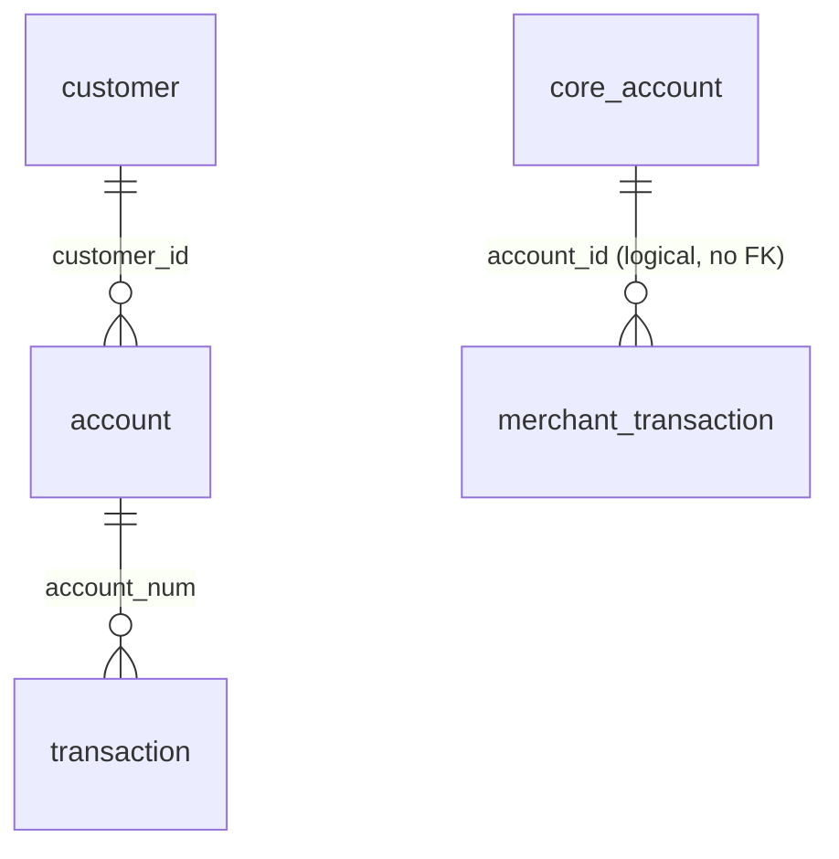

# Data Dictionary — LakeHouse_Banking

Describes every dataset the lakehouse uses: source tables in Postgres, how they land in the bronze layer,
known data quirks, and (later) silver / gold models. This is the single reference for "what does this column mean".

- **Maintenance:** any change to the data (new table/column, changed allowed values, new seed logic, new layer)
  is reflected here in the same change, and a line is added to the [Change log](#8-change-log).
- **Source of truth for schemas:** `init-sql/postgres/*.sql` (source) and `jobs/` (lakehouse layers).
  If this document and the code disagree, the code wins — fix the document.

---

## 1. Overview

| Layer | Location | Status |
|---|---|---|
| Source | Postgres database `${POSTGRES_DB}`, schema `public` (container `postgres-dungafk`) | Done |
| Bronze | Parquet `s3a://lab/bronze/<table>/` and/or Iceberg `lakehouse.bronze.<table>` | Done |
| Silver | Not designed yet | Planned |
| Gold | Not designed yet (transaction analytics marts) | Planned |

The source data has **two independent domains** that are *not* linked by any key:

| Domain | Tables | Purpose |
|---|---|---|
| **A. Retail banking (batch)** | `customer` → `account` → `transaction` | Main batch pipeline: bronze → silver → gold |
| **B. Core / merchant (CDC)** | `core_account`, `merchant_transaction` | Future Debezium CDC sources: upsert (`core_account`) and aggregate (`merchant_transaction`) cases |

---

## 2. Domain A — Retail banking

### 2.1 `customer`

One row per bank customer. Script: `init-sql/postgres/01_seed_customer.sql`.

| Column | Type | Null | Key | Allowed values / rule | Description |
|---|---|---|---|---|---|
| `customer_id` | SERIAL (int) | NO | PK | 1..20 | Surrogate customer ID |
| `full_name` | VARCHAR(200) | NO | | Vietnamese, with diacritics | Customer full name (PII) |
| `gender` | CHAR(1) | NO | | `M`, `F` | Gender |
| `date_of_birth` | DATE | NO | | 1970–1998 in seed | Date of birth (PII) |
| `phone` | VARCHAR(15) | YES | | 10-digit VN mobile | Phone number (PII) |
| `email` | VARCHAR(200) | YES | | | Email (PII) |
| `city` | VARCHAR(100) | YES | | TP.HCM, Hà Nội, Đà Nẵng, Hải Phòng, Cần Thơ | City of residence |
| `customer_segment` | VARCHAR(20) | NO | | `RETAIL`, `PRIORITY`, `VIP` | Customer tier |
| `is_active` | SMALLINT | NO | | `1` = active, `0` = inactive (default 1) | Active flag |
| `register_date` | DATE | NO | | 2016–2023 in seed | Date the customer joined the bank |
| `last_updated` | TIMESTAMP | NO | | default `NOW()` | Last change time (see quirks) |

**Seed:** 20 fixed rows (hand-written). 1 inactive customer (`Mai Thị Thu`).

### 2.2 `account`

One row per bank account; a customer has many accounts. Script: `02_seed_account.sql`.

| Column | Type | Null | Key | Allowed values / rule | Description |
|---|---|---|---|---|---|
| `account_num` | CHAR(12) | NO | PK | `'1900'` + 8 digits | Account number |
| `customer_id` | INTEGER | NO | FK → `customer.customer_id` | | Account owner |
| `account_type` | VARCHAR(20) | NO | | `CHECKING`, `SAVINGS`, `CREDIT` | Product type |
| `balance` | NUMERIC(15,2) | NO | | 0 – 500,000,000 (VND), default 0 | Current balance |
| `open_date` | DATE | NO | | within the last 5 years before seed date | Account open date |
| `status` | VARCHAR(10) | NO | | `ACTIVE`, `CLOSED`, `FROZEN` | Account status |
| `last_updated` | TIMESTAMP | NO | | default `NOW()` | Last change time |

**Seed:** 200 rows, round-robin over customers → **10 accounts per customer**.
`account_type`, `balance`, `open_date` are random; `status` is random with weights ACTIVE ≈ 4/6, CLOSED ≈ 1/6, FROZEN ≈ 1/6.

### 2.3 `transaction`

One row per account transaction. Script: `03_seed_transaction.sql`. Index on `transaction_date`.

| Column | Type | Null | Key | Allowed values / rule | Description |
|---|---|---|---|---|---|
| `transaction_id` | SERIAL (int) | NO | PK | 1..10000 | Transaction ID |
| `account_num` | CHAR(12) | NO | FK → `account.account_num` | | Account the transaction belongs to |
| `transaction_date` | TIMESTAMP | NO | | T-1 … T-5 (relative to seed date), random time of day | Transaction time |
| `amount` | NUMERIC(15,2) | NO | | 10,000 – 50,000,000 (VND), always positive | Transaction amount |
| `transaction_type` | VARCHAR(20) | NO | | `DEPOSIT`, `WITHDRAWAL`, `TRANSFER`, `PAYMENT` | Transaction type |
| `status` | VARCHAR(10) | NO | | `SUCCESS`, `FAILED`, `PENDING` | Result (weights SUCCESS ≈ 4/6, FAILED ≈ 1/6, PENDING ≈ 1/6) |
| `channel` | VARCHAR(10) | NO | | `ATM`, `ONLINE`, `MOBILE`, `BRANCH` | Channel used |
| `description` | VARCHAR(255) | YES | | `GD-D<day_offset>-<nnnn>` | Free text (seed: synthetic code) |

**Seed:** 2,000 rows/day × 5 days = **10,000 rows**, spread evenly → **50 transactions per account**.
There is no `last_updated` column — the table is append-only by design.

---

## 3. Domain B — Core account & merchant (CDC sources)

### 3.1 `core_account`

Core-banking account snapshot; future CDC **upsert** source (Debezium → Iceberg MERGE). Script: `04_core_account.sql`.

| Column | Type | Null | Key | Allowed values / rule | Description |
|---|---|---|---|---|---|
| `account_id` | VARCHAR(20) | NO | PK | `ACC001`… | Core account ID |
| `cif` | VARCHAR(15) | NO | | `CIF001`… | Customer Information File number |
| `customer_name` | VARCHAR(100) | NO | | unaccented Vietnamese | Customer name (PII) |
| `account_type` | VARCHAR(20) | NO | | `CHECKING`, `SAVINGS`, `BUSINESS` (no CHECK constraint) | Product type |
| `balance` | NUMERIC(18,2) | NO | | default 0 | Current balance (VND) |
| `status` | VARCHAR(10) | NO | | `ACTIVE`, `FROZEN`, `CLOSED` (no CHECK constraint), default `ACTIVE` | Account status |
| `open_date` | DATE | NO | | default `CURRENT_DATE` | Open date |
| `updated_at` | TIMESTAMP | NO | | default `NOW()` | Last change time |

**Seed:** 7 fixed rows (`ACC001`–`ACC007`), 1 `FROZEN` (`ACC005`).

### 3.2 `merchant_transaction`

Card / wallet payments at merchants; future CDC **aggregate** source (e.g. revenue per merchant/category). Script: `05_merchant_transaction.sql`.

| Column | Type | Null | Key | Allowed values / rule | Description |
|---|---|---|---|---|---|
| `txn_id` | VARCHAR(36) | NO | PK | UUID, default `gen_random_uuid()` | Transaction ID |
| `merchant_id` | VARCHAR(20) | NO | | `MER001`… | Merchant ID |
| `merchant_name` | VARCHAR(100) | NO | | | Merchant name (denormalized) |
| `category` | VARCHAR(30) | NO | | `FOOD_DRINK`, `TRANSPORT`, `SHOPPING`, `UTILITY`, `ENTERTAINMENT` (no CHECK) | Merchant category |
| `amount` | NUMERIC(18,2) | NO | | positive (VND) | Payment amount |
| `txn_status` | VARCHAR(10) | NO | | `SUCCESS`, `FAILED`, `PENDING` (no CHECK) | Result |
| `account_id` | VARCHAR(20) | NO | logical → `core_account.account_id` (no FK) | | Paying account |
| `txn_ts` | TIMESTAMP | NO | | default `NOW()` | Business time of the payment |
| `created_at` | TIMESTAMP | NO | | default `NOW()` | Row insert time |

**Seed:** 10 rows, `txn_ts` within the last 3 hours before seed time; 6 merchants (`MER001`–`MER006`); 1 `FAILED`.

---

## 4. Bronze layer

Produced by `jobs/ingest_data/ingest_minio.py`. **Full load, overwrite** on every run (idempotent; no history kept).
Columns are copied 1:1 from the source (Spark JDBC type mapping) plus two metadata columns.

| Table | Parquet path (`--target parquet`, default) | Iceberg table (`--target iceberg`) | Partitioning |
|---|---|---|---|
| `customer` | `s3a://lab/bronze/customer/` | `lakehouse.bronze.customer` | none |
| `account` | `s3a://lab/bronze/account/` | `lakehouse.bronze.account` | none |
| `transaction` | `s3a://lab/bronze/transaction/` | `lakehouse.bronze.transaction` | by day of `transaction_date` |
| `core_account` | `s3a://lab/bronze/core_account/` | `lakehouse.bronze.core_account` | none |
| `merchant_transaction` | `s3a://lab/bronze/merchant_transaction/` | `lakehouse.bronze.merchant_transaction` | by day of `txn_ts` |

**Added columns**

| Column | Type | Description |
|---|---|---|
| `_ingested_at` | timestamp | Time of the ingestion run (same value for the whole run) |
| `_source` | string | `postgres.public.<table>` |
| `partition_date` | date | **Parquet only**, partitioned tables only: `to_date(<partition column>)`, Hive-style folders `partition_date=YYYY-MM-DD/` |

Iceberg uses a hidden `days(<column>)` partition transform, so no extra column is added. Iceberg tables are
format v2, Snappy Parquet, stored under `s3://lakehouse/bronze/<table>/`, and queryable from Trino (`lakehouse.bronze.*`).

**Type mapping (source → Spark):** `SERIAL/INTEGER` → int, `VARCHAR/CHAR` → string, `NUMERIC(p,s)` → decimal(p,s),
`DATE` → date, `TIMESTAMP` → timestamp. Confirm exact types with `DESCRIBE lakehouse.bronze.<table>` in Trino.

---

## 5. Silver layer

_Not designed yet._ Open decisions (to be filled in when made):

- Input: bronze Parquet or bronze Iceberg?
- Load strategy: full load or incremental (watermark column per table)?
- Planned scope: cleansing, typing, deduplication.

## 6. Gold layer

_Not designed yet._ Planned: transaction analytics marts.

---

## 7. Known quirks & data-quality notes

Keep in mind when designing silver / gold:

1. **Domains A and B are unrelated.** `core_account.account_id` (`ACC001`) does not match `account.account_num`
   (`1900…`), and `cif` / `customer_name` do not link to `customer`. Names in `core_account` are unaccented.
2. **Dates are relative to the seed time.** `account.open_date`, `transaction.transaction_date` and
   `merchant_transaction.txn_ts` are computed from `CURRENT_DATE` / `NOW()` when the Postgres volume was first
   initialised, so they shift each time the stack is reset.
3. **Seed values are random** (`random()`): account types, balances, statuses, transaction amounts differ after every reset.
   Row counts and key distribution (10 accounts/customer, 50 transactions/account) are deterministic.
4. **`last_updated` / `updated_at` are not maintained automatically** — there is no trigger; they only hold the
   insert time unless the writer sets them. They are not reliable watermarks for incremental loads yet.
5. **`amount` is always positive** in `transaction`; direction must be derived from `transaction_type`
   (`DEPOSIT` = inflow; `WITHDRAWAL`, `TRANSFER`, `PAYMENT` = outflow).
6. **Transactions on non-active accounts:** seed data assigns transactions to `CLOSED` / `FROZEN` accounts too.
7. **`balance` is not derived from transactions** — balances and transaction amounts are generated independently.
8. **Domain B has no CHECK constraints** on `account_type`, `status`, `category`, `txn_status` — silver must validate them.
9. **`is_active` is SMALLINT 0/1**, not boolean — cast in silver.
10. **PII:** `full_name`, `date_of_birth`, `phone`, `email`, `customer_name` are personal data (synthetic here).
    Sample emails use real domains (`@gmail.com`, `@yahoo.com`).

---

## 8. Change log

| Date | Change |
|---|---|
| 2026-11-24 | Document created from `init-sql/postgres/01–05` and `jobs/ingest_data/ingest_minio.py`. Row counts taken from seed scripts (Docker was not running; not yet checked against the live DB). |
